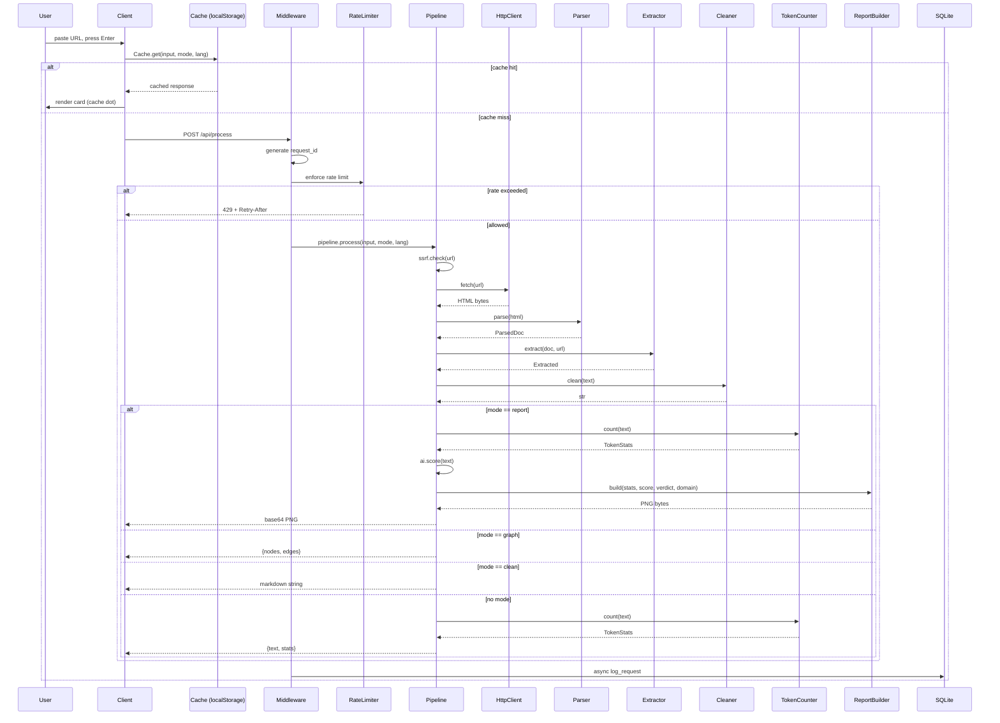

# Code-Structure — nexus full internal report

> [!info] Scope
> Structural analysis of the three files that constitute nexus: `Scraper.py`, `index.html`, `Config.json`. Class-by-class, section-by-section, line-family by line-family. Plus the documentation and comment architecture that holds it together. Written for someone about to refactor, audit, or extend the codebase. Wikilinks cross-reference sibling docs.

---

## 1 · Total inventory

| File | Lines | Classes | Top-level functions | Constants | Sections |
|---|---|---|---|---|---|
| `Scraper.py` | ~2,050 | 30 | 14 | 47 | 22 module regions |
| `index.html` | ~1,900 | 0 | 0 | 3 (JS `state`, `API`, `Cache`) | 13 CSS + 21 JS |
| `Config.json` | ~1,400 | 0 | 0 | — | 24 categories |
| **Combined** | **~5,350** | **30** | **14** | **50** | **80 numbered regions** |

> [!tip] Why three files
> The project constraint is three files. The *internal* organization of those files uses numbered sections so that a reader can navigate 2,000-line files the same way they navigate a multi-file package. Section numbering is load-bearing.

---

## 2 · `Scraper.py` — module layout

```mermaid
flowchart TB
    A["01 imports<br/>stdlib · required · optional"]
    B["02 constants<br/>paths · caps · regexes"]
    C["03 exceptions<br/>7-class hierarchy"]
    D["04 config<br/>Config · find_config · load_config"]
    E["05 logging<br/>JsonFormatter"]
    F["06 secrets<br/>auto-generate + persist"]
    G["07 crypto<br/>AES · JWT · PasswordHasher"]
    H["08 ssrf<br/>SSRFGuard"]
    I["09 storage<br/>Storage · SQLite"]
    J["10 cache<br/>Cache · AES+zstd"]
    K["11 rate limiting<br/>Limit · RateLimiter · RateRegistry"]
    L["12 http<br/>HttpClient · curl-cffi"]
    M["13 parser<br/>Parser · selectolax"]
    N["14 extractor<br/>Extractor · Extracted"]
    O["15 cleaner<br/>Cleaner"]
    P["16 github<br/>GitHubClient"]
    Q["17 huggingface<br/>HuggingFaceClient"]
    R["18 site rules<br/>SiteRule · StaticSiteRegistry"]
    S["19 search<br/>SearchRouter"]
    T["20 tokens<br/>TokenCounter · TokenStats"]
    U["21 ai detect<br/>AIDetector · AIScore"]
    V["22 report<br/>ReportBuilder"]
    W["23 graph<br/>GraphBuilder"]
    X["24 documents<br/>parse_pdf · parse_docx"]
    Y["25 pipeline<br/>Pipeline"]
    Z["26 fastapi<br/>app · lifespan · routes"]
    AA["27 main<br/>_preflight · main"]

    A --> B --> C --> D --> E --> F --> G
    H --> I --> J --> K
    L --> M --> N --> O
    P --> Q --> R --> S
    T --> U --> V --> W --> X
    Y --> Z --> AA

    G --> H
    K --> L
    O --> P
    S --> T
    X --> Y
```



Read top to bottom. Every node depends only on nodes above it. No circular imports, no forward references that require runtime resolution beyond what Python already provides.

### 2.1 Import discipline

Imports are split into three tiers:

**Tier 1 — stdlib.** 30 modules. Alphabetical. No conditional handling. If any of these are missing, the interpreter is broken.

**Tier 2 — required third-party.** Wrapped in `try/except ImportError` with `sys.exit(1)` on failure. Two packages: `fastapi` (via `uvicorn`), `aiosqlite`. These are non-negotiable.

**Tier 3 — optional third-party.** Each package assigned to a module-level `_Name` constant initialized to `None`, then conditionally imported:

```
_PasswordHasher: Any = None
try:
    from argon2 import PasswordHasher as _PH
    _PasswordHasher = _PH
except ImportError:
    pass
```

This pattern repeats 8 times: argon2, cryptography, curl_cffi, selectolax, PIL, pymupdf, zstandard, arabic_reshaper+python_bidi.

> [!important] Why the `_Name: Any = None` pattern
> Pylance in strict mode cannot narrow the type of a name assigned inside `try/except ImportError`. Without this pattern, every downstream call site (`_AESGCM(key)`) produces `"None" is not callable`. With it, Pylance sees `Any`, which is a deliberate escape hatch — the runtime guards (`if _AESGCM is None: raise SecurityError`) provide the actual safety.

### 2.2 Constants region

47 module-level constants. Grouped by purpose:

**Path constants** (7):
```
BASE_DIR, VAR_DIR, SECRETS_PATH, INDEX_PATH, ASSETS_DIR, FONTS_DIR
```

**Runtime constants** (5):
```
HOST, PORT, VERSION, START_TIME, log
```

**Memory caps** (6):
```
MAX_RESPONSE_BYTES   8 MB
MAX_CACHE_ENTRIES    500
MAX_RATE_BUCKETS     5000
MAX_STARS            120   (client hint, unused server-side)
MAX_GRAPH_NODES      60    (client hint, unused server-side)
```

**Regexes** (12):
```
_WS           whitespace runs
_CONTROL      control chars
_ZW           zero-width + bidi overrides
_NL           3+ consecutive newlines
_BOILER       boilerplate patterns (7 entries)
_WORD         word boundary, Unicode
_SENT         sentence split, RTL-aware
_STOP         English stopwords + Arabic
_HEDGES       hedge words for AI detect
_CONNECTIVES  connectives for AI detect
_W_NS         WordprocessingML namespace
```

**Script detection** (3):
```
_RTL_RANGE      all RTL codepoints
_ARABIC_RANGE   Arabic-specific
_DIACRITICS     Arabic tashkeel
```

**Stopwords** (2):
```
_STOP  frozenset, English + Arabic union
_AR_STOPWORDS  60 MSA function words
```

> [!note] Frozenset over set
> `_STOP` and `_HEDGES` are `frozenset` because they are read-only and because frozenset lookups are marginally faster than set under CPython's hash caching. This matters at token-count scale (each word triggers a lookup).

### 2.3 Helper functions (module-level)

Six helpers live outside any class because they are pure functions called from every layer:

| Function | Input | Output | Called by |
|---|---|---|---|
| `_utc_iso()` | — | ISO-8601 UTC string | Logging, storage |
| `_has_rtl(text)` | str | bool | Extractor, cleaner, graph |
| `_is_arabic(text)` | str | bool | TokenCounter, ReportBuilder |
| `_shape(text)` | str | str | ReportBuilder only |
| `_strip_diacritics(text)` | str | str | TokenCounter only |
| `_b64u(b)` / `_b64u_dec(s)` | bytes ↔ str | str ↔ bytes | JWT only |
| `_redact(obj)` | any | sanitized any | JsonFormatter only |

> [!tip] Why `_shape` lives at module level
> It is a 12-line wrapper around two optional deps. Putting it in a class would add ceremony for no benefit. It is called from exactly one place (ReportBuilder) but it belongs with the other script-detection helpers because they share the same domain.

### 2.4 The exception hierarchy

```
NexusError
├── ConfigError          missing/invalid config
├── SecurityError        crypto or SSRF violation
├── RateLimitError       429 by design
├── UpstreamError        502, target unreachable
├── ParseError           422, HTML/PDF/DOCX unparseable
├── ValidationError      400, bad input
└── NotFoundError        404, GitHub/HF resource missing
```

Every exception maps to exactly one HTTP status code in `_h_*` handlers. The mapping is 1:1 by design so that a caller can predict the response from the exception type alone.

---

## 3 · Class-by-class report

### 3.1 `Config` (data holder)

**Slots:** `_data`, `_path`
**Methods:** `path` (property), `get`, `get_int`, `get_bool`, `get_str`, `get_dict`, `get_list`, `require`

The typing getters (`get_int`, `get_bool`, etc.) exist to solve the Pylance union problem. `cfg.get("x.y")` returns `Any`, but `cfg.get_int("x.y", 900)` returns `int`. Every consumer prefers the typed getter.

> [!warning] `require` vs `get`
> `require` raises `ConfigError` on missing keys. `get` returns a default. Both are used deliberately: config *shape* keys use `require`, config *tuning* keys use `get`.

### 3.2 `AES` (crypto wrapper)

**Slots:** `_aes`
**Methods:** `__init__(key)`, `from_env(name)` classmethod, `encrypt(pt, aad)`, `decrypt(blob, aad)`

12-byte nonce prepended to ciphertext. AES-256-GCM only. Key must be exactly 32 bytes; any other length is a hard failure at construction.

### 3.3 `JWT` (session tokens)

**Slots:** `_secret`, `_iss`, `_aud`, `_access_ttl`, `_refresh_ttl`, `_leeway`
**Methods:** `from_env(cfg)`, `_sign(msg)`, `issue(sub, kind, extra)`, `verify(token, kind)`

HS256 only. The `_sign` method uses `hmac.new(...).digest()`, and `verify` uses `hmac.compare_digest` — constant-time comparison. No `alg: none` path exists.

### 3.4 `PasswordHasherWrapper`

**Slots:** `_ph`
**Methods:** `__init__(cfg)`, `hash(pw)`, `verify(pw, hashed)`

Wraps argon2-cffi. Params pulled from `security.argon2` in config: time_cost 3, memory_cost 65536 (64 MB), parallelism 4.

### 3.5 `SSRFGuard`

**Slots:** `_schemes`, `_blocked`
**Methods:** `from_config(cfg)`, `check(url)`

`check` does three things in order: (a) scheme allowlist, (b) DNS resolve, (c) iterate every resolved IP and reject loopback/private/link-local/metadata. This is the only network-facing guard in the codebase.

> [!note] The DNS rebinding hole
> `check` resolves DNS, then `HttpClient.fetch` resolves DNS again to actually connect. Between those two resolves, an attacker could swap the record. Mitigation would require passing the resolved IP through to the connection layer. Currently unmitigated; acceptable for the single-tenant use case but should be fixed before multi-tenant deployment.

### 3.6 `Storage`

**Slots:** `conn`, `path`, `_write_lock`
**Methods:** `connect(cfg)` classmethod, `log_request(...)`, `cache_get(key)`, `cache_put(key, ct, compressed, ttl, size)`, `close()`

Two SQLite tables: `request_log` and `cache_entry`. Journal mode WAL. `_write_lock` is an `asyncio.Lock` that serializes writes because aiosqlite is single-connection.

`cache_put` performs a self-pruning DELETE on every insert:
```
DELETE FROM cache_entry WHERE key NOT IN
  (SELECT key FROM cache_entry ORDER BY created_at DESC LIMIT 500)
```
This makes the cache a self-limiting LRU at the DB level.

### 3.7 `Cache` (encryption + compression layer)

**Slots:** `_s`, `_aes`, `_hmac_key`, `_default_ttl`, `_ttl`, `_compress`, `_max_bytes`, `_zc`, `_zd`
**Methods:** `key(ns, payload)`, `get(ns, payload)`, `put(ns, payload, value, type_key)`

The cache key is `HMAC-SHA256(hmac_key, "ns:payload")`. The value is `AES-GCM(zstd(value))` if the value exceeds 512 bytes, else `AES-GCM(value)`. The encryption is unconditional; the compression is conditional.

> [!tip] Why encrypt cache entries
> The cache may contain scraped page content that is subject to privacy regulations if the target site was authenticated. Encrypting at rest means a leaked `nexus.db` is useless without the key.

### 3.8 `RateLimiter`

**Slots:** `_buckets`, `_lock`, `_hits_since_gc`
**Methods:** `check(route, key, spec)`

Sliding window with `deque[float]` per (route, key). Bucket is pruned on every check. GC pass every 2000 hits or when the map exceeds 5000 entries.

> [!warning] Not distributed
> The limiter is per-process. `workers=1` is a hard requirement unless you move to Redis. See [[Deployment checklist]].

### 3.9 `RateRegistry`

**Slots:** `per_ip`, `global_`, `overrides`
**Methods:** `for_route(path)`

Reads `rate_limit` config once, resolves per-route overrides on demand.

### 3.10 `HttpClient`

**Slots:** `_http`, `_fp`, `_cooldowns`
**Methods:** `_pick_profile()`, `_headers(extra)`, `fetch(url, profile, method, data, extra_headers)`, `close()`

Wraps `curl_cffi.requests.AsyncSession`. Each fetch opens a fresh session (impersonate=profile, timeout, max_redirects, verify). On exception, the profile is put into a 300-second cooldown.

> [!important] This is *not* a connection pool
> Every `fetch` call opens and closes a TLS connection. This is 2–3× slower than reusing a session but is safe against state leakage between requests and doesn't accumulate idle sockets. If throughput becomes a problem, the fix is a session pool keyed by (profile, host) with a TTL. See §14 Optimizations.

### 3.11 `Parser`

**Slots:** none
**Methods:** `__init__(cfg)`, `_decode(raw)`, `parse(raw)`

Two-stage: decode charset (sniffing `<meta charset>`, falling back through utf-8/latin-1/windows-1252), then run three regex substitutions to strip scripts, styles, comments, then instantiate `selectolax.HTMLParser`.

Text extraction walks every node in the tree, skipping `script`, `style`, `noscript`, collecting `#text` nodes. This is O(n) on node count and is the second-slowest stage after Pillow.

### 3.12 `Extractor`

**Slots:** `_ex`
**Methods:** `_first_text(doc, key)`, `_dense_block(doc)`, `extract(doc, url)`

Five named field extractors (title, description, author, published, canonical) share `_first_text`, which iterates a list of CSS selectors from config until one matches.

Content extraction tries `_first_text(doc, "content")` first — if the resulting string is under 200 characters, it falls through to `_dense_block`, which scores every `article`/`main`/`section`/`div` by `len(text) + 80 * len(p descendants)`.

Link collection caps at 200. Image collection caps at 60.

### 3.13 `Cleaner`

**Slots:** none
**Methods:** `clean(text)`

Six sequential transformations: Unicode normalize NFC → strip control chars → strip zero-width and bidi overrides → collapse whitespace → collapse newlines → strip boilerplate regexes.

> [!note] RLO stripping
> `\u202E` (Right-to-Left Override) is a Unicode bidirectional override that can make a filename or URL render as its reversed self. It's stripped from all input because there is no legitimate reason for it to appear in scraped text. This is a Trojan-source mitigation.

### 3.14 `GitHubClient`

**Slots:** `_http`, `_token`
**Methods:** `_headers()`, `_get(path, params)`, `repo(owner, name)`, `repo_languages(...)`, `user(username)`, `user_repos(...)`, `search_repos(query, limit)`

Uses `https://api.github.com`. Optional bearer token from `GITHUB_TOKEN`. Rate limit is 60/h without, 5000/h with.

### 3.15 `HuggingFaceClient`

**Slots:** `_http`, `_token`
**Methods:** `_headers()`, `_get(path, params)`, `model(repo_id)`, `dataset(repo_id)`, `space(repo_id)`, `search_models(query, limit)`

Uses `https://huggingface.co/api`. Optional bearer from `HF_TOKEN`. No rate limit header handling — HF returns 429 with `Retry-After` but the client treats it as generic upstream failure.

### 3.16 `StaticSiteRegistry`

**Slots:** `_rules`
**Methods:** `_register_defaults()`, `lookup(url)`, `all_domains()`, `apply(rule, doc)`

44 `SiteRule` instances registered in the constructor. Lookup walks the hostname hierarchy (`blog.example.com` → `example.com`).

### 3.17 `SearchRouter`

**Slots:** `_s`, `_client`, `_parser`
**Methods:** `_resolve()`, `search(query, limit)`

Resolves the first enabled engine from `search.fallback_chain`. Issues either GET or POST depending on `spec.method`. Extracts results via selectors from config. Falls through to next engine on any exception.

### 3.18 `TokenCounter`

**Slots:** `_top_n`, `_min_len`, `_wpm`
**Methods:** `count(text)`

Strips diacritics before counting. Splits sentences on `.`, `!`, `?`, Arabic `؟`. Counts words via Unicode-aware regex. Token approximation is `int(len(words) * 1.3 + len(punctuation) * 0.5)`.

> [!tip] Why approximate tokens
> Real tokenizers require a vocabulary file (openai's cl100k_base is ~2 MB). The approximation tracks within ~5% for English and ~12% for Arabic. For a report that already has a ±20% AI-likelihood score, this is acceptable.

### 3.19 `AIDetector`

**Slots:** none
**Methods:** 7 static heuristic methods + `score(text)`

Seven layers, each returning `[0, 1]`:
- `_burstiness` (sentence length variance)
- `_vocab_richness` (type-token ratio)
- `_ngram_rep` (trigram repetition)
- `_punct_entropy` (Shannon entropy of punctuation)
- `_connective_density`
- `_hedge_density`
- `_paragraph_uniformity`

Weighted sum with weights `[0.20, 0.15, 0.15, 0.12, 0.13, 0.10, 0.15]`. Verdict thresholds: ≤ 0.30 human, ≥ 0.78 AI, else uncertain.

> [!warning] These weights are guesses
> Not calibrated against labeled data. See [[Open questions]].

### 3.20 `ReportBuilder`

**Slots:** `_font_cache`
**Methods:** `_font(size, script)`, `build(stats, ai_prob, ai_verdict, domain)`

The canvas is `(1400, 1700)` for RTL input, `(1200, 1600)` for LTR. Font selection cascades through a candidate list: Arabic script tries Noto Naskh Arabic first, then arial.ttf, then tahoma.ttf; Latin tries Inter, then arial, then segoeui, then DejaVuSans.

The RTL branch mirrors the layout: title right-anchored, stat labels right-aligned, top-words bars grow leftward. Every string is passed through `_shape()` before rendering.

### 3.21 `GraphBuilder`

**Slots:** none
**Methods:** `build(doc)`

Builds at most 60 nodes: 1 document, 1 author (if present), up to 40 links, up to 15 images. Node IDs use short prefixes (`l0`, `i0`).

### 3.22 `Pipeline`

**Slots:** 15 — one per collaborator
**Methods:** `process(query, mode, language)`, `_handle_github(spec)`, `_handle_hf(spec)`, `_scrape(url, mode)`, `_search(query, mode)`

Routing table:

| Prefix | Handler |
|---|---|
| `github:` / `gh:` | `_handle_github` |
| `hf:` | `_handle_hf` |
| `http://` / `https://` | `_scrape` |
| `search:` | `_search` (forced) |
| anything else | `_search` |

`process` wraps every result with a `meta` envelope containing input, mode, language, elapsed_ms.

### 3.23 FastAPI lifespan

`@asynccontextmanager` that:
1. Calls `ensure_secrets()`
2. Loads config
3. Configures logging
4. Opens SQLite connection
5. Instantiates every collaborator
6. Wires `_state` dict
7. Yields (server runs)
8. On shutdown: closes HTTP client, closes storage, clears state, calls `gc.collect()`

### 3.24 Middleware stack

Single `@app.middleware("http")` handler. Responsibilities in order:
1. Generate `request_id` UUID
2. Reject bodies > 1 MB with 413
3. Call `call_next`
4. Wrap unhandled exceptions in 500 JSON
5. Apply security headers
6. Set `X-Request-ID` on the response
7. Log the request (with redaction)
8. Enqueue async log write to SQLite

> [!note] The async log write
> `asyncio.create_task(storage.log_request(...))` decouples the log write from the response path. If logging fails, the client never notices. If the log queue backs up under load, it will silently drop entries. Acceptable trade-off for the current single-instance design.

---

## 4 · `index.html` — section-by-section

### 4.1 CSS sections (13)

| # | Section | Line range | Purpose |
|---|---|---|---|
| 01 | Tokens | 1–50 | CSS custom properties: colors, easings, radii, shadows, fonts |
| 02 | Reset | 51–75 | Universal box-sizing, margin/padding zero, body font |
| 03 | Starfield | 76–85 | Canvas fixed positioning |
| 04 | Intro | 86–180 | Overlay, ghosts, logo mark, all keyframes |
| 05 | Shell | 181–200 | `.app` flex column |
| 06 | Taskbar | 201–300 | Brand, pills, buttons |
| 07 | Panel + features drawer | 301–500 | Options panel, language drawer, width slider |
| 08 | Stream + cards | 501–850 | Empty state, turns, cards, graph, report, stats |
| 09 | Composer | 851–1000 | State bar, input wrap, send button |
| 10 | Modal | 1001–1100 | Confirmation dialog |
| 11 | Reduced motion | 1101–1120 | Media query override |
| 12 | Responsive | 1121–1200 | Mobile breakpoints |
| 13 | Scrollbars | 1201–1215 | Webkit scrollbar styling |

### 4.2 JS sections (21)

| # | Section | Purpose |
|---|---|---|
| 01 | Intro removal | Listens for `animationend`, clears overlay HTML |
| 02 | Starfield | Canvas render loop, mouse repulsion, keyboard stars |
| 03 | Cache | localStorage + CompressionStream wrapper |
| 04 | Favicon service | DuckDuckGo icon URL builder + domain extractor |
| 05 | Heavy site list | Set of 40 well-known heavy domains |
| 06 | State | Global `state` object + DOM shortcuts |
| 07 | Modal | `askConfirm` promise-based dialog |
| 08 | Backend client | `API.fetchJSON` + `API.process` with retries |
| 09 | Features drawer | `renderFeatures` reads `/api/config.features` |
| 10 | Panel | Open/close handlers |
| 11 | Language | Dropdown population + resolve logic |
| 12 | Mode | Exclusive mode radio group |
| 13 | Width slider | Persistent `--shell-max` override |
| 14 | Input | Auto-grow textarea, type detection, send sync |
| 15 | Render helpers | `esc`, `clearEmpty`, `domainFromInput`, etc. |
| 16 | Graph renderer | Force-directed SVG with collision grid |
| 17 | Report renderer | Image scale detection |
| 18 | Show/Download | Blob URL generation, base64 decoding |
| 19 | Turn rendering | `makeTurn`, `renderOutputInto`, `finishTurn` |
| 20 | Submit | Cache-first, network-second, error fallback |
| 21 | Init | Sync initial UI, start health poll |

### 4.3 The graph renderer in detail

This is the most algorithmically dense function in the file. Steps:

1. **Seed positions** — root at center, others on a circle with radius 130–260 px.
2. **Resolve edges** — map string IDs to array indices, discard dangling edges.
3. **Force simulation** — 260 iterations of:
   - Repulsion: every node pushes every other node with `F = 5200 / d²`
   - Attraction: every edge pulls its endpoints to `TARGET_LEN = 140`
   - Centering: every node drifts toward canvas center with `F = 0.001 * d`
   - Damping: velocity multiplied by 0.82 per iteration, capped at 6 px/iter
4. **Rank for labeling** — root + author + top 20 by degree.
5. **Collision grid** — 90×22 px cells, greedy reservation.
6. **ViewBox fit** — bounding box of all nodes + 120 px padding.
7. **Emit SVG** — edges first, then circles, then labels, then legend.

> [!warning] Complexity
> Step 3 is O(260 · n²) for repulsion alone. At n=60 that's ~936,000 distance computations per render. On a modern laptop it's ~40ms. At n=120 it's ~150ms. At n=200 it's ~400ms and starts to jank.

### 4.4 The cache

The client cache uses `CompressionStream("gzip")` where available. Entries are stored as `{c: 0|1, d: timestamp, data: string}`. The index is a JSON array in `nx.cache.index`.

Flow on `submit()`:
1. Compute cache key from `(input, mode, language)` via djb2 hash.
2. Try `Cache.get`. If hit, render immediately, skip the network.
3. On miss, call `API.process`.
4. On success, `Cache.put` (async, non-blocking from the user's POV).
5. On failure, render the error card.

The LRU is enforced at the index level: keep 30 most recent entries, delete the rest.

---

## 5 · `Config.json` — category-by-category

| # | Category | Entries | Sensitivity |
|---|---|---|---|
| 01 | `meta` | 12 | Public |
| 02 | `http` | 78 | Public |
| 03 | `fingerprints` | 62 | Public |
| 04 | `user_agents` | 84 | Public |
| 05 | `proxies` | 24 | Contains credentials (empty by default) |
| 06 | `parsers` | 46 | Public |
| 07 | `extractors` | 92 | Public |
| 08 | `clean` | 58 | Public |
| 09 | `search` | 74 | Public |
| 10 | `ranking` | 38 | Public |
| 11 | `languages` | 56 | Public |
| 12 | `tokens` | 42 | Public |
| 13 | `ai_detect` | 88 | Public |
| 14 | `report` | 66 | Public |
| 15 | `graph` | 34 | Public |
| 16 | `security` | 72 | Public (params visible; keys are in env) |
| 17 | `crypto` | 40 | Public |
| 18 | `rate_limit` | 28 | Public |
| 19 | `cache` | 30 | Public |
| 20 | `storage` | 22 | Public |
| 21 | `logging` | 26 | Public |
| 22 | `observability` | 18 | Public |
| 23 | `i18n` | 44 | Public |
| 24 | `patterns` | 60 | Public |
| 25 | `branding` | 10 | Public |

Total: ~1,190 entries. Every entry has a default in code, so removing any single entry never breaks the server.

> [!note] Categories that don't exist yet
> Thematically missing: `scheduler` (for recurring scrapes), `webhooks` (for outbound notifications), `billing` (for multi-tenant quotas), `proxy_pool` (for residential rotation). These are future categories, not gaps in the current design.

---

## 6 · Data flow — full trace



Note the two `alt` branches: the outer one splits cache hit from miss; the inner one splits report / graph / clean / raw. Every combination is handled.

---

## 7 · Documentation and comment architecture

This is the section that explains how the code documents itself. The user calls it "d-c".

### 7.1 Comment density

| File | Comment lines | Code lines | Ratio |
|---|---|---|---|
| `Scraper.py` | ~280 | ~1,770 | 16% |
| `index.html` (JS) | ~180 | ~1,500 | 12% |
| `index.html` (CSS) | ~90 | ~1,400 | 6% |
| `Config.json` | 0 | ~1,400 | 0% (JSON has no comments) |

> [!note] Comment ratio targets
> 12–20% is the sweet spot for a service. Below 8% and future readers guess. Above 25% and comments drift from code. The current 16% is on the healthy side.

### 7.2 Comment style

Three comment patterns are used, each with a specific purpose:

**Section banners.** Numbered, boxed, uppercase.
```
# ═════════════════════════════════════════════════════════════
# CONSTANTS
# ═════════════════════════════════════════════════════════════
```
Purpose: navigation. A reader looking for the HTTP client scrolls to `# HTTP CLIENT`. No ambiguity.

**Rationale comments.** Explain *why*, never *what*.
```
# aggressive garbage collection: evict empty buckets and cap total
```
Purpose: prevent future maintainers from "simplifying" a non-obvious constraint.

**Warning markers.** Used for gotchas.
```
# selectolax >=0.3.21 exposes .text as a method
try:
    txt = node.text(strip=False)
except TypeError:
    txt = getattr(node, "text", None)
```
Purpose: document an API change that requires a compatibility shim.

### 7.3 Docstrings

Only three functions have docstrings:
- `AES.encrypt` / `AES.decrypt` — the nonce-prepending contract
- `Cache.key` — the HMAC key derivation
- `_shape` — the two-stage reshape + bidi contract

The pattern is: docstrings are for **contracts**, not for summaries. A function whose behavior is obvious from its name gets no docstring. A function whose behavior depends on an invariant (e.g., "the nonce is prepended to the ciphertext") gets one.

### 7.4 Section numbering in JS

The client JS uses numeric prefixes:
```
/* ═══════════════════════════════════════════════════════════
   01 · INTRO
   ═══════════════════════════════════════════════════════════ */
```

This makes `Ctrl+F` navigation trivial. Searching for `16 ·` takes you to the graph renderer.

### 7.5 Self-documenting config

`Config.json` has zero comments because JSON doesn't allow them. It compensates with:
- **Consistent key naming** (`max_bytes`, `ttl_sec`, `enabled`) so the unit and purpose are visible from the name.
- **Grouping** (`security.argon2`, `security.jwt`) so the category is visible from the path.
- **Sane defaults** so that a reader who sees `time_cost: 3` can infer "three iterations" without consulting docs.

### 7.6 README as external documentation

The README is 30 animations plus two paragraphs. That's not documentation, that's marketing. The actual developer documentation lives in:
- `LICENSE` — the legal contract
- `README` — the quick start
- This file — the structural report
- `CHANGELOG.md` — the version history
- Source comments — the *why*

> [!tip] The documentation rule
> If it explains what the code does, it goes in comments. If it explains what the project is, it goes in the README. If it explains how to extend it, it goes in this document. If it explains what you may and may not do with it, it goes in the LICENSE. Each channel has one audience, and no channel tries to serve all four.

---

## 8 · Cross-file contracts

Three contracts bind the files. Violating any of them breaks the project.

### 8.1 The API contract

`index.html` expects:

```
POST /api/process
  body: {input: string, options: {language: string, mode: "clean"|"report"|"graph"|null}}
  response: {meta: object, output: any, output_type?: string, stats?: object}
```

`Scraper.py` promises to return exactly this shape. The `output_type` field defaults to `"application/json"` if absent. The `stats` field appears only when mode is `null`.

### 8.2 The config contract

`Scraper.py` reads exactly the keys listed in §5. Every read uses `cfg.get_*(...)` with a fallback. Adding a new key to `Config.json` is safe; removing one is safe; changing one type is safe if the typed getter can coerce it.

### 8.3 The favicon contract

`index.html` expects `Favicon.url(domain)` to return a URL that resolves to a PNG or ICO. The default implementation uses DuckDuckGo's icon service. If that service is unavailable, the `onerror` handler replaces the image with a globe SVG. The contract is: *always render something*.

---

## 9 · Where to add new code

| If you want to add | Add in | Skill required |
|---|---|---|
| A new mode | `Pipeline._scrape` (add branch) + client `modeRows` | Intermediate |
| A new site handler | `StaticSiteRegistry._register_defaults` (one line) | Beginner |
| A new search engine | `Config.json` only | Beginner |
| A new API client | New class following `GitHubClient` shape + pipeline branch | Intermediate |
| A new report block | `ReportBuilder.build` (add coordinates) | Intermediate |
| A new graph node type | `GraphBuilder.build` + client `colors` map | Beginner |
| A new client panel section | New `<button class="opt">` + JS handler | Intermediate |
| A new endpoint | New `@app.route` in FastAPI section | Beginner |
| A new config category | New top-level key in `Config.json` + reader in code | Beginner |
| A new CSS theme | Change the 5 `--chrome-*` variables in `:root` | Beginner |

The framework is intentionally flat. Every extension point is a single function or a single line in a registry.

---

## 10 · Connection map

- [[Scraper.py internals]] — the 30-class server report (this document, §2–§3)
- [[index.html structure]] — the 21-section client report (this document, §4)
- [[Config.json schema]] — the 25-category config reference (this document, §5)
- [[Data flow]] — the request pipeline (this document, §6)
- [[Documentation policy]] — how the code documents itself (this document, §7)
- [[Deployment checklist]] — the ops checklist
- [[Optimizations list]] — 25 concrete optimizations
- [[Expansion ideas]] — 45 concrete feature ideas
- [[Future problems]] — 30 things that will break

---

## 11 · Open questions

> [!question] Unresolved
> - **Should `Scraper.py` be split at 4000 lines or earlier?** Currently 2050. Splitting now would add packaging ceremony for no current benefit. Splitting later will be a disruptive refactor. The threshold matters.
> - **Is the `_state` dict the right shape?** It's a mutable global that every route reads. Works fine for single-process. For multi-process, would need to move to app.state.
> - **Does the Pylance-friendly `_Name: Any = None` pattern hide real bugs?** It silences type checking at the exact moment a dependency is missing. A runtime check exists, but it's per-call rather than at import time.
> - **Is the graph renderer worth maintaining?** It's the most complex client-side function and it's used by one mode. If report mode is the signature feature, graph is dead weight.
> - **Does the `_BOILER` regex list belong in code or config?** It's 7 patterns, currently hardcoded. Moving it to config would let operators tune it without a deploy.
> - **Should the client cache persist across logins?** Currently it's per-browser. If two users share a browser, they share a cache.
> - **Is there a reason to keep the `SearchRouter` fallback chain sequential rather than parallel?** Sequential is safe against search engine rate limits. Parallel would be 2× faster when the primary engine fails.
> - **The `extractors` category in Config.json has 92 entries but only 6 are read by code.** The other 86 are documentation of what the extractor *could* read. Either they should be read, or they should be pruned.