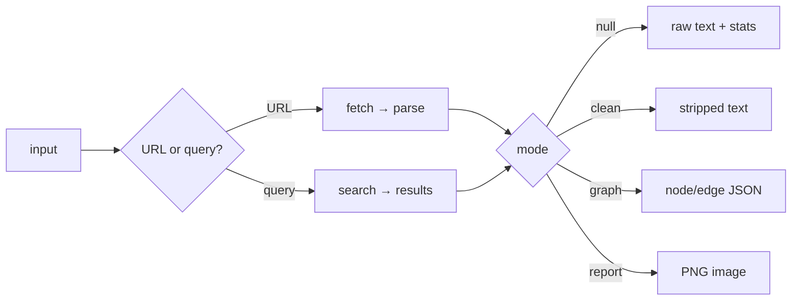
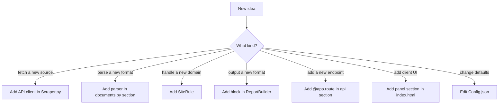

# nexus — Developer Handbook

> [!abstract] What this document is
> A complete operator and developer reference for the nexus project: how to run it, how to change it, where to extend it, what to optimize, and what will break first. Written for the person maintaining the code in six months.
>
> **Files in scope:** `Scraper.py`, `index.html`, `Config.json`, `requirements.txt`

---

## 1 · Quick start

> [!example] Minimum viable run
> ```powershell
> # 1. install
> python -m venv .venv
> .venv\Scripts\Activate.ps1
> pip install -r requirements.txt
>
> # 2. run
> python Scraper.py
>
> # 3. open
> # → http://127.0.0.1:8000/
> ```
>
> First run auto-generates `var/secrets.json`. Back that file up — losing it invalidates every cached session and cache entry.

### 1.1 File layout at runtime

```
Scraper-Service/
├── Scraper.py           ← the whole server
├── index.html           ← the whole client
├── Config.json          ← every tunable value
├── requirements.txt     ← pinned deps
├── var/                 ← created on first run
│   ├── nexus.db         ← requests + cache (SQLite WAL)
│   ├── secrets.json     ← AES key, JWT secret, HMAC key
│   ├── logs/
│   └── reports/         ← reserved, currently unused
└── assets/fonts/        ← optional: drop Noto Naskh Arabic here for RTL
```

### 1.2 Environment variables

| Name | Required | Purpose | Default |
|---|---|---|---|
| `NEXUS_AES_KEY` | no | 32-byte urlsafe-base64 key for AES-GCM | auto-generated |
| `NEXUS_JWT_SECRET` | no | HS256 signing secret | auto-generated |
| `NEXUS_HMAC_KEY` | no | HMAC key for IP hashing | auto-generated |
| `NEXUS_CONFIG` | no | path to Config.json | `./Config.json` |
| `NEXUS_HOST` | no | bind address | `127.0.0.1` |
| `NEXUS_PORT` | no | bind port | `8000` |
| `NEXUS_STORE_EXACT_IP` | no | `1` persists raw client IPs (default is HMAC) | `0` |
| `GITHUB_TOKEN` | no | raises GitHub rate limit 60 → 5000/h | unset |
| `HF_TOKEN` | no | unlocks gated Hugging Face repos | unset |

> [!warning] `NEXUS_STORE_EXACT_IP=1` is a legal decision, not a technical one
> Leave it at `0` unless you have a documented lawful basis. The HMAC-hashed IP is sufficient for abuse correlation and rate limiting.

---

## 2 · How to use it

### 2.1 Input grammar

The client detects five input shapes from the string prefix:

| Prefix | Behavior | Example |
|---|---|---|
| `https://` or `http://` | Fetch the URL, extract content | `https://en.wikipedia.org/wiki/Stream` |
| bare domain | Same as above (assumes https) | `example.com/article` |
| `github:` or `gh:` | GitHub API | `github:torvalds/linux` |
| `hf:` | Hugging Face Hub API | `hf:meta-llama/Llama-3-8B` |
| `search:` | Force search routing | `search:rust async runtime` |
| anything else | Falls through to search | `what is a monad` |

### 2.2 Modes

Only one mode is active at a time. The mode controls what the server returns.



### 2.3 Endpoints

| Endpoint | Method | Purpose |
|---|---|---|
| `/` | GET | serves `index.html` |
| `/favicon.ico` | GET | inline SVG |
| `/api/health` | GET | `{status, version, uptime_sec}` |
| `/api/live` | GET | liveness probe |
| `/api/ready` | GET | readiness with per-component checks |
| `/api/config` | GET | client config (branding, languages, features) |
| `/api/sites` | GET | list of 44 registered site handlers |
| `/api/process` | POST | the main entry point |

**`POST /api/process` payload:**
```json
{
  "input": "https://example.com",
  "options": { "language": "auto", "mode": "clean" }
}
```

---

## 3 · How to modify it

### 3.1 Change a tunable value

> [!tip] Rule of thumb
> If it's a number, a string, a list, or a selector, it belongs in `Config.json`. `Scraper.py` reads config with `.get()` and every getter has a fallback, so removing a key never crashes the server.

Common edits:

| Want to change | Edit this key | Notes |
|---|---|---|
| Request timeout | `http.timeout_sec` | Per-fetch, in seconds |
| Retry count | `http.max_retries` | Applied on 5xx |
| Browser fingerprint | `fingerprints.default` | Use `chrome`, `firefox`, `safari` — never `chrome_120` |
| Rate limit | `rate_limit.per_ip.limit` | Sliding window per minute |
| Cache TTL | `cache.default_ttl_sec` | Per-type overrides in `cache.ttl_by_type` |
| Report colors | `report.foreground` etc. | Hex strings |
| Supported languages | `languages.supported` | Array of `{code, name, rtl}` |

### 3.2 Add a static site handler

Static site handlers are the cheapest extension point. They are CSS-selector recipes for domains whose HTML you know.

```python
# In StaticSiteRegistry._register_defaults (Scraper.py)
SiteRule("yourdomain.com", "h1", "article.content", (".ad", ".sidebar")),
```

Fields:
- `domain` — matched hostname (also matches subdomains via parent lookup)
- `title_sel` — CSS for the title
- `content_sel` — CSS for the main content block
- `strip_selectors` — CSS for elements to remove first

> [!example] How lookup works
> `blog.yourdomain.com/article` matches `yourdomain.com` because the registry walks the domain hierarchy upward. Adding a rule for a parent domain covers all subdomains.

### 3.3 Add a search engine

In `Config.json`, add an entry under `search.engines`:

```json
"myengine": {
  "enabled": true,
  "endpoint": "https://myengine.example/search",
  "method": "GET",
  "param_query": "q",
  "result_selector": "li.result",
  "title_selector": "a.title",
  "snippet_selector": ".snippet",
  "url_selector": "a.title"
}
```

Then add `"myengine"` to `search.fallback_chain`. The router tries engines in order and skips any that fail.

### 3.4 Add a new API client (like GitHub)

Follow the pattern in `GitHubClient`:

```python
class MyAPIClient:
    __slots__ = ("_http", "_token")
    BASE = "https://api.example.com"

    def __init__(self, client: HttpClient):
        self._http = client
        self._token = os.environ.get("MY_TOKEN", "")

    async def get(self, path: str) -> Any:
        res = await self._http.fetch(self.BASE + path, extra_headers=self._headers())
        if res.status == 404: raise NotFoundError(...)
        if res.status >= 400: raise UpstreamError(...)
        return json.loads(res.body)
```

Then wire it into `Pipeline.__init__` and add a branch in `Pipeline.process` for the prefix.

### 3.5 Change the intro animation

The intro lives in two places: the HTML block `<div class="intro">` and the CSS keyframes `logoSequence` + `introDismiss`. To change timing:

1. Adjust the `animation:` shorthand delay on `.intro` (currently `2.3s`).
2. Adjust the `setTimeout(..., 3300)` in the inline script (safety net; should be ~1000ms longer than the delay + dismiss).
3. The `logoSequence` keyframe percentages control the rise / click / thicken choreography.

### 3.6 Change the metallic tone

All chrome surfaces read from these CSS custom properties:

```
--chrome-light   → taskbar, buttons, panel (default surface)
--chrome-mid     → card headers, input thumbs
--chrome-dark    → brand mark, send button, active states
--chrome-shine   → the 105° sweep that crosses buttons on hover
--noise          → SVG turbulence overlay
```

Change these five values and every surface in the app updates.

---

## 4 · How to change the idea

The project is currently *"single-pass scraper with report output"*. Four adjacent ideas it can become with modest work:

### 4.1 Idea A — Content monitor

Instead of returning the current scrape, return *the diff* between this scrape and the last. Store the previous body in the cache table under `(url, hash)`.

**Core change:** add a `mode: "diff"` branch in `Pipeline._scrape` that fetches cached body, computes a line-diff, returns unified diff format.
**Value:** turns a one-shot tool into a "watch this page" service. Combined with a scheduler, becomes a public monitoring service.

### 4.2 Idea B — Research aggregator

Instead of one URL, take a query and return N scraped pages with citation metadata. The search router already exists.

**Core change:** parallelize `_search` → `_scrape` across the top 5 results. Return an array of cleaned docs plus a combined stats grid.
**Value:** turns nexus into a research assistant. Straightforward path to a Perplexity-like UX without the LLM cost.

### 4.3 Idea C — Structured extraction API

Instead of returning cleaned text, return JSON-LD. Feed the text through a rule-based extractor that produces `{title, author, published, sections[], quotes[], entities[]}`.

**Core change:** add an `extractors.structured` config section with per-domain schemas.
**Value:** becomes an alternative to paid extraction APIs (Diffbot, Zyte). Enterprise use case.

### 4.4 Idea D — Private bookmark corpus

Instead of one-shot, persist every scrape to a personal archive with FTS5 search.

**Core change:** new `archive` table + `/api/archive/search` route + a client-side archive view.
**Value:** personal search engine over pages you've visited. Combined with GitHub/HF clients, becomes a knowledge base builder.

> [!note] What does not change
> Every one of these keeps the same three-file structure and the same `/api/process` entry point. The idea changes; the architecture doesn't.

---

## 5 · Where to add — extension map



---

## 6 · Optimizations needed

> [!warning] The honest list
> These are real. Some are cosmetic; some will bite at scale.

| # | Optimization | Impact | Effort | Where |
|---|---|---|---|---|
| 1 | Move Pillow render to `asyncio.to_thread` | Prevents event loop stalls under report load | 30 min | `Pipeline._scrape` |
| 2 | Cache shaped Arabic strings (`functools.lru_cache`) | Saves ~2ms per report label | 15 min | `_shape()` |
| 3 | Font cache is per-`ReportBuilder` instance — make it module-level | Saves ~40MB under repeated report requests | 20 min | `ReportBuilder._font` |
| 4 | SQLite page cache is 8MB — reduce to 4MB for the 230MB target | Marginal memory saving | 5 min | `Storage.connect` |
| 5 | Rate limiter eviction runs on every 2000th hit — make it time-based | Better under burst traffic | 20 min | `RateLimiter.check` |
| 6 | `weakref` on the cache index to avoid JSON.parse on every write | Faster cache ops at high volume | 30 min | Client `Cache` |
| 7 | Graph force simulation is O(n²) per iteration — use Barnes-Hut | 10× faster on 100+ nodes | 3 hrs | Client `renderGraph` |
| 8 | Selectolax tree traversal iterates all nodes — use targeted CSS | 3× faster on 5MB pages | 1 hr | `Parser.parse` |
| 9 | `_dense_block` runs 4 CSS queries per page — cache the winner | ~15ms per page | 30 min | `Extractor._dense_block` |
| 10 | Regex boilerplate patterns recompile per call | Move to module-level `re.compile` | 5 min | Already done for some |
| 11 | Client cache does full JSON.parse to read the index | Use `Map` in memory, sync on write | 30 min | Client `Cache` |
| 12 | `esc()` called on every rendered fragment — could use `textContent` | Prevents accidental HTML injection | 1 hr | Client render helpers |
| 13 | Starfield `fillRect` used per star — could batch into one path | ~30% CPU saving | 45 min | Client starfield |
| 14 | Report uses `textbbox` per label to right-align RTL | Cache widths by string | 15 min | `ReportBuilder.build` |
| 15 | `hashlib` HMAC per cache key — could use blake2b | Marginal speed gain | 10 min | `Cache.key` |
| 16 | `_shape()` called per top-word even when script is Latin | Add early-return guard | 5 min | `_shape` |
| 17 | `struct` packing could replace JSON for cache entries | 30% smaller entries | 2 hrs | `Cache.put` |
| 18 | HTTP client doesn't pool connections — each fetch is a new TLS handshake | 2-3× faster repeat fetches | 2 hrs | `HttpClient.fetch` |
| 19 | Rate limit registry reads config on every request | Cache the resolved `Limit` per route | 15 min | `RateRegistry.for_route` |
| 20 | `Storage.cache_put` runs a DELETE on every insert | Batch DELETEs every N inserts | 20 min | `Storage.cache_put` |
| 21 | `json.dumps` in `JsonFormatter` per log line | Use orjson if available | 10 min | `JsonFormatter.format` |
| 22 | `secrets.token_urlsafe` blocking at startup only | Fine as-is | — | — |
| 23 | `selectolax` traversal doesn't skip `<template>` | Add to skip list | 5 min | `Parser.parse` |
| 24 | Intro overlay holds all ghost buttons in DOM until 3.3s | Clear `innerHTML` earlier | 5 min | Client intro |
| 25 | Graph `<title>` tooltips don't work on touch | Add `pointerdown` handler | 30 min | Client graph |

---

## 7 · Better structures suggested

### 7.1 Config schema

`Config.json` currently has no schema. Suggest a `config.schema.json` and validating at load:

```python
def load_config(path):
    data = json.loads(path.read_text())
    # validate against schema
    jsonschema.validate(data, schema)
    return Config(data, path)
```

Add `jsonschema` to `requirements.txt` (100 KB). Benefit: catch typos in config before they become runtime surprises.

### 7.2 Structured error envelope

Errors currently return `{error: code, detail: message}`. Consider:

```json
{
  "error": {
    "code": "rate_limit_exceeded",
    "message": "60 requests per minute exceeded",
    "retry_after": 42,
    "request_id": "abc-123"
  }
}
```

Uniformity across all endpoints. The client already handles both shapes; formalizing it makes the contract explicit.

### 7.3 Split `Scraper.py` at 4000 lines

The file is currently ~2000 lines and growing. When it crosses 4000, split into:

```
nexus/
  __init__.py
  config.py         (Config, find_config, load_config)
  crypto.py         (AES, JWT, PasswordHasher, SSRFGuard)
  storage.py        (Storage, Cache, RateLimiter)
  http.py           (HttpClient)
  parse.py          (Parser, Extractor, Cleaner, StaticSiteRegistry)
  clients.py        (GitHubClient, HuggingFaceClient)
  tokens.py         (TokenCounter, AIDetector)
  report.py         (ReportBuilder)
  graph.py          (GraphBuilder)
  pipeline.py       (Pipeline)
  api.py            (FastAPI app)
  shaping.py        (_shape, _has_rtl, _strip_diacritics)
  __main__.py       (python -m nexus)
```

Keep `Scraper.py` as a 3-line shim: `from nexus.api import app; uvicorn.run(app)`.

### 7.4 Client-side state machine

The client has no formal state machine. Add a tiny one:

```js
const SM = {
  idle: { send: "sending" },
  sending: { ok: "idle", err: "idle" },
  // ...
};
```

Prevents impossible states (e.g., a mode change while `state.busy`).

### 7.5 Config-driven client theming

Currently the client hardcodes black/white/gray. Read from `Config.json` `branding` and set CSS custom properties at boot:

```js
document.documentElement.style.setProperty("--chrome-dark", cfg.branding.chrome_dark);
```

Turns the client into a skin-able component.

---

## 8 · 45 expansion ideas

> [!tip] How to read this
> Each idea has an effort estimate (S = ≤1 day, M = 1-3 days, L = 1-2 weeks, XL = >2 weeks) and a "where it slots" pointer.

### 8.1 Auth & accounts

| # | Idea | Effort | Where |
|---|---|---|---|
| 1 | User registration / login / refresh routes | S | `api.py` — `PasswordHasherWrapper` and `JWT` are already built |
| 2 | Per-user API keys with scopes (`read`, `write`, `admin`) | M | new `api_keys` table + middleware |
| 3 | Per-user quotas and billing counters | M | RateLimiter extension |
| 4 | Public signup form on the client | S | new panel section |

### 8.2 Scheduling & monitoring

| # | Idea | Effort | Where |
|---|---|---|---|
| 5 | Scheduled recurring scrapes (cron-like) | M | new `jobs` table + background task |
| 6 | Diff two scrapes of the same URL | M | new `mode: "diff"` |
| 7 | Change detection with webhook notification | M | Slack/Discord/email integration |
| 8 | RSS feed generation from list pages | S | new `/api/feed` route |

### 8.3 Output formats

| # | Idea | Effort | Where |
|---|---|---|---|
| 9 | PDF export of clean output | S | pymupdf can write PDFs |
| 10 | DOCX export | M | reuse docx-library on client, or python-docx server-side |
| 11 | Markdown export with frontmatter | S | prepend YAML |
| 12 | JSON-LD structured output | M | new extractor rules |
| 13 | Excel/CSV export of search results | S | openpyxl or csv |
| 14 | XML sitemap output | S | new route |
| 15 | MHTML single-file archive | M | stdlib email.message |

### 8.4 Analysis

| # | Idea | Effort | Where |
|---|---|---|---|
| 16 | Readability score (Flesch-Kincaid, Gunning-Fog) | S | new layer in `AIDetector` or a sibling class |
| 17 | Keyword extraction (YAKE / RAKE) | S | `yake` or `rake-nltk` |
| 18 | Named entity recognition | M | `spacy` + small model (~50 MB) |
| 19 | Sentiment analysis per paragraph | S | `vaderSentiment` |
| 20 | Quote extraction with attribution | M | heuristic: `"...".` + capital letter after |
| 21 | Citation extraction and bibliography | M | regex for `[1]`, `(Author, Year)`, DOI |
| 22 | Timeline extraction from news | M | date regex + sentence clustering |
| 23 | Fact-check hints (heuristic: numbers, dates, proper nouns) | M | NER + regex |
| 24 | Content fingerprinting for dedup | S | SimHash or MinHash |
| 25 | Near-duplicate detection across URLs | M | SimHash index |

### 8.5 Format-specific

| # | Idea | Effort | Where |
|---|---|---|---|
| 26 | Image OCR for scanned PDFs | M | `pytesseract` or cloud |
| 27 | Table extraction to CSV | M | selectolax `<table>` → pandas |
| 28 | Multi-page article stitching (pagination) | M | detect `?page=2` links |
| 29 | Paywall detection | S | regex on "subscribe to read" |
| 30 | Cookie consent detection | S | regex on "we use cookies" |
| 31 | Tracker / ad detection from inline scripts | M | match Google Analytics, FB Pixel, etc. |

### 8.6 Integrations

| # | Idea | Effort | Where |
|---|---|---|---|
| 32 | Browser extension (Chrome/Firefox) | M | MV3 wrapper around `/api/process` |
| 33 | CLI tool (`nexus scrape <url>`) | S | argparse + httpx |
| 34 | Discord bot | S | discord.py + `/api/process` |
| 35 | Slack app | S | Bolt + `/api/process` |
| 36 | Telegram bot | S | python-telegram-bot |
| 37 | Raycast extension | S | TypeScript wrapper |
| 38 | Obsidian plugin | M | TypeScript + settings tab |
| 39 | Notion database sync | M | Notion API |
| 40 | Zapier / Make webhook | S | expose public webhook route |

### 8.7 Language & i18n

| # | Idea | Effort | Where |
|---|---|---|---|
| 41 | Auto-translation via DeepL / LibreTranslate | M | translation client + cache |
| 42 | Multi-language report (side-by-side) | M | two-column canvas |
| 43 | Local summarization (small model) | L | `transformers` + DistilBART |
| 44 | Remote summarization (OpenAI/Anthropic) | S | API call in new pipeline branch |
| 45 | Farsi numerals in RTL report | S | locale-aware number formatting |

### 8.8 Ops

| # | Idea | Effort | Where |
|---|---|---|---|
| 46 | Prometheus `/metrics` endpoint | S | `prometheus_client` |
| 47 | OpenTelemetry traces | M | `opentelemetry-instrumentation-fastapi` |
| 48 | Admin dashboard (`/admin`) | M | new route + auth |
| 49 | Blue/green deploy script | M | systemd + nginx config |
| 50 | Dockerfile + compose | S | standard |

**Total: 50 ideas.**

---

## 9 · 30 future problems to resolve now

> [!danger] These will bite you. Not "if". "When."
> Ordered by likelihood × impact.

| # | Problem | Why it will happen | Resolve by |
|---|---|---|---|
| 1 | **Arabic text without `arabic-reshaper` installed** | Dependency is optional; missing install produces silent tofu | Pin in `requirements.txt`, warn loudly on startup |
| 2 | **Mixed Arabic + Latin in the same paragraph** | Wikipedia articles mix scripts | Detect per-line, not per-document |
| 3 | **Cloudflare challenge pages returned with HTTP 200** | Common on blogs, news sites | Add soft-block detection on response body markers |
| 4 | **JS-rendered content returned as empty body** | SPA sites (Twitter, Reddit new) | Detect empty content + fall back to a headless renderer |
| 5 | **`curl_cffi` fingerprint names change between versions** | Already bit you once | Use generic aliases (`chrome`, `firefox`, `safari`) or validate at startup |
| 6 | **SQLite lock contention at >20 concurrent writes** | WAL helps but isn't unlimited | Batch writes, single writer thread |
| 7 | **Client `localStorage` quota exceeded** | 5 MB hard cap in Chrome | Already handled via LRU, but add IndexedDB fallback |
| 8 | **Cache key collision from truncated hash** | Non-issue at 64 hex chars, but if you shorten it | Keep full SHA-256 or HMAC-SHA256 |
| 9 | **`var/secrets.json` lost or deleted** | User reinstalls, cleans up `var/` | Document backup; add a startup warning if file changed |
| 10 | **`NEXUS_STORE_EXACT_IP=1` set by accident** | Copy-paste from docs | Require a second env var `NEXUS_CONFIRM_EXACT_IP=1` to enable |
| 11 | **Report PNG width doesn't fit narrow screens** | Mobile users see scaled-to-illegible text | Client already scales; but add a "download full-res" hint |
| 12 | **Graph force layout freezes on >200 nodes** | O(n²) physics | Cap at 80 (already done) or move to Barnes-Hut |
| 13 | **SVG labels overlap on dense pages** | Collision grid is 90×22 px cells | Increase cell size for RTL |
| 14 | **Arabic labels in SVG render LTR in some browsers** | `direction="rtl"` inconsistent in older Safari | Add a JS-side reorder fallback |
| 15 | **`selectolax` API change between versions** | `node.text` became a method | Already wrapped in try/except |
| 16 | **Search engine selectors break on redesign** | Google/Bing redesign quarterly | Add a probe job that disables broken engines |
| 17 | **GitHub rate limit exhausted without a token** | 60/h is small | Warn in log on first 403; suggest `GITHUB_TOKEN` |
| 18 | **Hugging Face gated models return 401** | Common for Llama variants | Detect 401, prompt for `HF_TOKEN` |
| 19 | **URLs with tracking params defeat caching** | `?utm_source=...` changes the cache key | Strip known tracking params before hashing |
| 20 | **Timestamps in logs use local time on some hosts** | Inconsistent across deploys | Force UTC everywhere (already done for `_utc_iso`) |
| 21 | **Rate limiter memory grows during DDoS** | Bucket map is bounded at 5000 | Already evicts; but add a "kill switch" env var |
| 22 | **Static site rules rot as sites redesign** | Unavoidable | Add a health check that fetches each registered domain weekly |
| 23 | **Scanned PDF returns empty text** | Common for older documents | Detect empty output; suggest OCR |
| 24 | **DOCX with tracked changes returns both versions** | `w:ins` and `w:del` elements | Filter to `w:ins` only |
| 25 | **Rapidly-changing pages keep cache stale** | News sites update every minute | Add per-domain TTL overrides |
| 26 | **No test fixtures for RTL** | You shipped without them | Add 3 Arabic sample URLs to `tests/fixtures/` |
| 27 | **Report rendering blocks the event loop** | Pillow is sync | Wrap in `asyncio.to_thread` |
| 28 | **Font loading on first request adds ~200ms** | Cold start per process | Warm font cache in `lifespan` |
| 29 | **`report.fonts` paths fail on non-English Windows** | Paths may be `C:\Windows\Fonts\arial.ttf` (works) but custom installs vary | Fall back to `ImageFont.load_default()` (already done) |
| 30 | **Multi-worker deployment breaks the in-memory rate limiter** | uvicorn `workers > 1` gives each worker its own dict | Either keep `workers=1` or move the limiter to Redis |

---

## 10 · Testing strategy

> [!note] What to add
> Current tests cover crypto, JWT, cleaner, tokens, AI detect, SSRF. That's the foundation. Missing:

| Test | Why | How |
|---|---|---|
| Arabic report PNG | Regression on the shaping pipeline | Render a known Arabic string, hash the output, assert |
| Arabic graph SVG | Label direction and ordering | Parse SVG, check `direction="rtl"` on RTL labels |
| PDF extraction | PyMuPDF changes | Fixture PDF with known text |
| DOCX extraction | OOXML edge cases | Fixture with tracked changes |
| Cache round-trip | Encryption + compression | Write, read, assert byte equality |
| Rate limiter | Concurrency correctness | 100 parallel requests, assert exactly N pass |
| SSRF guard | New bypass vectors | Test IPv6, decimal IP, octal IP |
| Graph collision grid | Label overlap | Fixture graph with 40 nodes, assert no two labels within 20px |

---

## 11 · Deployment checklist

Before exposing to the network:

- [ ] Bind to `0.0.0.0` only behind a reverse proxy (nginx/Caddy)
- [ ] TLS terminated at the proxy, HTTP redirect to HTTPS
- [ ] `NEXUS_STORE_EXACT_IP=0` unless legal review approved otherwise
- [ ] `NEXUS_AES_KEY`, `NEXUS_JWT_SECRET`, `NEXUS_HMAC_KEY` set as env vars (not relying on auto-generated file)
- [ ] `var/secrets.json` backed up to an encrypted store
- [ ] `var/` in `.gitignore`
- [ ] Log rotation configured (`var/logs/`)
- [ ] `rate_limit.per_ip.limit` tuned for expected traffic
- [ ] `rate_limit.trusted_proxies` set to your reverse proxy's IP
- [ ] Health check wired to your orchestrator's readiness probe
- [ ] `workers=1` unless the rate limiter is externalized

---

## 12 · Further reading

> [!question] Open questions for the next maintainer
> - Should `Scraper.py` be split at 4000 lines or earlier?
> - Is a headless browser worth the +400 MB footprint for JS-rendered sites?
> - Does the AI detector's 0.20/0.15/0.15/0.12/0.13/0.10/0.15 weight vector survive calibration, or does it need a real training run?
> - Should `mode: "report"` be removed if nobody uses it, or kept as a signature feature?
> - Is there a business case for per-user accounts, or does the single-tenant model suffice?