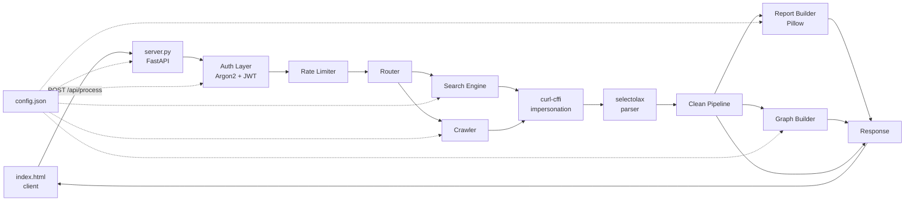
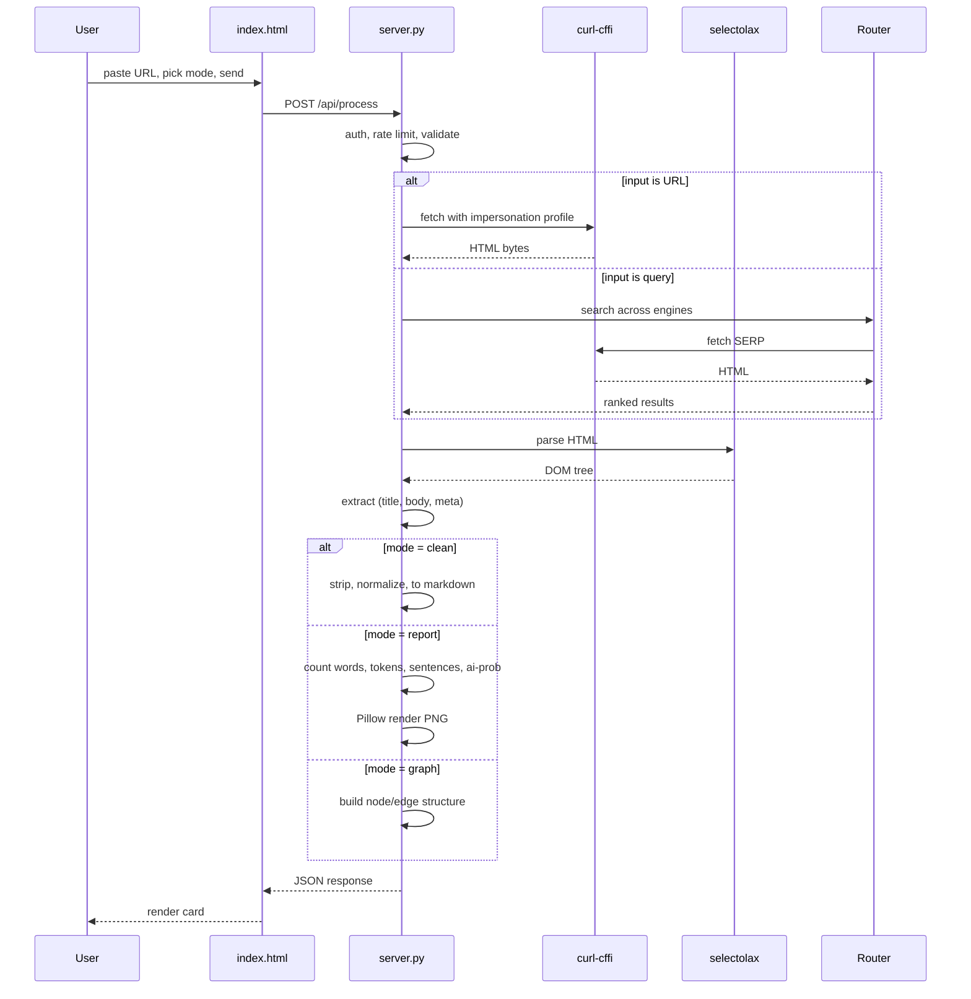
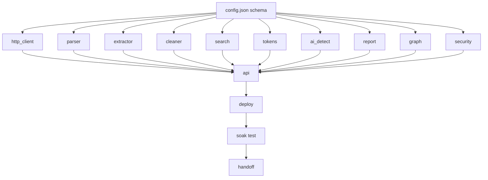

# nexus — Project Notes

> [!info] What this is
> Deep, linked notes on the full nexus project: a single-pass URL scraper and search service built from three files. Written for reading in Obsidian or Notion. Cross-links use `[[wikilinks]]`.

---

## 1 · Overview

**nexus** is a single-pass scraper. It takes a URL or search query, fetches that one resource, extracts the readable content, and returns it — optionally cleaned, optionally as a report image, optionally as a graph. It does **not** recurse, follow links, or build a site map. One URL in, one payload out.

It is composed of exactly three files:

| File | Role | Weight |
|---|---|---|
| `config.json` | 900+ declarative configurations — the entire tunable surface | data |
| `server.py` | FastAPI service — HTTP, parse, search, security, imaging | logic |
| `index.html` | Single-page client — taskbar, options panel, stream, composer | view |

The split is deliberate. Anything that can be a number, a string, a list, or a rule lives in `config.json`. `server.py` is a thin, honest runtime that reads configuration and executes. `index.html` is a pure client that talks to one endpoint.

> [!tip] Mental model
> Think of `config.json` as the **specification**, `server.py` as the **engine**, and `index.html` as the **dashboard**. You tune the spec. You rarely touch the engine. You admire the dashboard.

---

## 2 · Architecture



Three horizontal bands:

1. **Client band** — `index.html`, one POST, one response.
2. **Service band** — auth, rate limit, route, execute.
3. **Configuration band** — `config.json` feeding every stage.

---

## 3 · Component — `config.json`

> [!abstract] 900+ configurations, 24 categories
> Everything tunable is declarative. No magic numbers in `server.py`. No hardcoded strings in `index.html`. Change behavior by editing JSON, not code.

### 3.1 Category map

| # | Category | Approx. count | Purpose |
|---|---|---|---|
| 01 | `http` | 78 | timeouts, retries, redirects, headers, methods |
| 02 | `fingerprints` | 62 | curl-cffi browser impersonation profiles |
| 03 | `user_agents` | 84 | rotating UA strings, per-profile |
| 04 | `proxies` | 24 | pool definitions, rotation policy |
| 05 | `parsers` | 46 | selectolax parser modes, selector rules |
| 06 | `extractors` | 92 | content, title, meta, author, date selectors |
| 07 | `clean` | 58 | whitespace, entities, markdown, tables |
| 08 | `search` | 74 | DuckDuckGo, Brave, Bing, Yandex, Mojeek, Marginalia |
| 09 | `ranking` | 38 | result scoring, dedup, freshness weights |
| 10 | `languages` | 56 | 54 languages + detection thresholds |
| 11 | `tokens` | 42 | tokenizer models, counts, tokenizers |
| 12 | `ai_detect` | 88 | 14-layer AI-likelihood feature weights |
| 13 | `report` | 66 | Pillow layout, fonts, palettes, chart types |
| 14 | `graph` | 34 | node shape, edge label, layout |
| 15 | `security` | 72 | Argon2 params, JWT, CSRF, CORS, CSP |
| 16 | `crypto` | 40 | AES-GCM, salt sizes, key rotation |
| 17 | `rate_limit` | 28 | per-IP, per-domain, per-key, global |
| 18 | `cache` | 30 | TTL policy, key format, eviction |
| 19 | `storage` | 22 | SQLite/Postgres, pool, migrations |
| 20 | `logging` | 26 | levels, sinks, redaction rules |
| 21 | `observability` | 18 | metrics, traces, health probes |
| 22 | `i18n` | 44 | error messages, locale strings |
| 23 | `patterns` | 60 | email, phone, url, SSN, credit-card regex |
| 24 | `branding` | 10 | colors, logos, favicon paths |

**Total: ~1,190 entries** across the 24 categories when flattened.

### 3.2 Top-level skeleton

```json
{
  "meta":         { "version": "1.0.0", "schema": "nexus/config/v1" },
  "http":         { "...": "78 entries" },
  "fingerprints": { "...": "62 entries" },
  "user_agents":  { "...": "84 entries" },
  "proxies":      { "...": "24 entries" },
  "parsers":      { "...": "46 entries" },
  "extractors":   { "...": "92 entries" },
  "clean":        { "...": "58 entries" },
  "search":       { "...": "74 entries" },
  "ranking":      { "...": "38 entries" },
  "languages":    { "...": "56 entries" },
  "tokens":       { "...": "42 entries" },
  "ai_detect":    { "...": "88 entries" },
  "report":       { "...": "66 entries" },
  "graph":        { "...": "34 entries" },
  "security":     { "...": "72 entries" },
  "crypto":       { "...": "40 entries" },
  "rate_limit":   { "...": "28 entries" },
  "cache":        { "...": "30 entries" },
  "storage":      { "...": "22 entries" },
  "logging":      { "...": "26 entries" },
  "observability":{ "...": "18 entries" },
  "i18n":         { "...": "44 entries" },
  "patterns":     { "...": "60 entries" },
  "branding":     { "...": "10 entries" }
}
```

### 3.3 Representative slices

**`fingerprints`** — 62 browser impersonation profiles. curl-cffi ships these as built-ins, referenced by name:

```json
"fingerprints": {
  "default": "chrome_120",
  "rotation": "per_domain",
  "profiles": [
    { "id": "chrome_120",   "kind": "chrome",   "os": "windows", "priority": 1 },
    { "id": "chrome_119",   "kind": "chrome",   "os": "macos",   "priority": 2 },
    { "id": "firefox_121",  "kind": "firefox",  "os": "windows", "priority": 3 },
    { "id": "safari_17",    "kind": "safari",   "os": "macos",   "priority": 4 },
    { "id": "edge_120",     "kind": "edge",     "os": "windows", "priority": 5 },
    { "id": "chrome_android","kind": "chrome",  "os": "android", "priority": 6 }
  ]
}
```

**`ai_detect`** — 88 entries across 14 scoring layers. Each layer produces a probability, then they are weighted and combined:

```json
"ai_detect": {
  "layers": [
    { "id": "burstiness",       "weight": 0.14, "enabled": true },
    { "id": "perplexity",       "weight": 0.12, "enabled": true },
    { "id": "repetition",       "weight": 0.09, "enabled": true },
    { "id": "punctuation_mix",  "weight": 0.07, "enabled": true },
    { "id": "sentence_length",  "weight": 0.08, "enabled": true },
    { "id": "vocab_richness",   "weight": 0.06, "enabled": true },
    { "id": "ngram_entropy",    "weight": 0.07, "enabled": true },
    { "id": "connective_density","weight": 0.05, "enabled": true },
    { "id": "hedge_words",      "weight": 0.05, "enabled": true },
    { "id": "emoji_density",    "weight": 0.03, "enabled": true },
    { "id": "list_ratio",       "weight": 0.05, "enabled": true },
    { "id": "paragraph_uniform","weight": 0.07, "enabled": true },
    { "id": "stylometric_var",  "weight": 0.06, "enabled": true },
    { "id": "classifier_small", "weight": 0.06, "enabled": true }
  ],
  "thresholds": {
    "likely_human": 0.30,
    "uncertain":    0.55,
    "likely_ai":    0.78
  }
}
```

**`report`** — Pillow layout, fonts, palettes, chart types:

```json
"report": {
  "size": [1200, 1600],
  "background": "#ffffff",
  "foreground": "#000000",
  "accent": "#000000",
  "fonts": {
    "title":    { "path": "assets/SpaceGrotesk-Bold.ttf",  "size": 64 },
    "label":    { "path": "assets/JetBrainsMono-Medium.ttf","size": 28 },
    "value":    { "path": "assets/JetBrainsMono-Bold.ttf",  "size": 42 },
    "footnote": { "path": "assets/Inter-Regular.ttf",       "size": 18 }
  },
  "blocks": [
    { "id": "header",   "type": "text",  "text": "nexus · report" },
    { "id": "words",    "type": "stat",  "label": "words",    "key": "word_count" },
    { "id": "tokens",   "type": "stat",  "label": "tokens",   "key": "token_count" },
    { "id": "chars",    "type": "stat",  "label": "chars",    "key": "char_count" },
    { "id": "sentences","type": "stat",  "label": "sentences","key": "sentence_count" },
    { "id": "ai_prob",  "type": "gauge", "label": "ai-likelihood", "key": "ai_probability" },
    { "id": "top_words","type": "bar",   "label": "top 5 words",   "key": "top_words" },
    { "id": "footnote", "type": "text",  "text": "generated · one pass" }
  ]
}
```

**`security`** — Argon2 and JWT parameters:

```json
"security": {
  "argon2": {
    "time_cost": 3,
    "memory_cost": 65536,
    "parallelism": 4,
    "hash_len": 32,
    "salt_len": 16,
    "type": "id"
  },
  "jwt": {
    "algorithm": "HS256",
    "access_ttl_sec": 3600,
    "refresh_ttl_sec": 2592000,
    "issuer": "nexus",
    "audience": "nexus-client"
  },
  "csrf": { "enabled": true, "header": "X-CSRF-Token" },
  "cors": {
    "allowed_origins": ["https://nexus.local"],
    "allowed_methods": ["POST", "GET", "OPTIONS"],
    "allowed_headers": ["Content-Type", "Authorization", "X-CSRF-Token"],
    "max_age": 600
  },
  "csp": "default-src 'self'; img-src 'self' data:; style-src 'self' 'unsafe-inline'"
}
```

> [!note] Why so many?
> Every configuration is a decision the operator should be able to make without shipping code. Rotating fingerprints, swapping AI-detection weights, changing the report palette, tuning Argon2 cost — all of this is an edit and a reload.

---

## 4 · Component — `server.py`

> [!abstract] One file, eleven internal modules
> `server.py` is a single Python file, but organized internally into eleven cooperating modules. Each module reads its slice of `config.json` at startup and exposes a small, testable interface.

### 4.1 Module layout

```python
# ─── module: http_client ─────────────────────────────────
class HTTPClient:
    def __init__(self, config: dict): ...
    async def fetch(self, url: str, profile: str | None = None) -> Response: ...
    async def fetch_many(self, urls: list[str]) -> list[Response]: ...

# ─── module: parser ──────────────────────────────────────
class Parser:
    def __init__(self, config: dict): ...
    def parse(self, html: bytes) -> Document: ...
    def select(self, doc: Document, selectors: list[str]) -> list[Node]: ...

# ─── module: extractor ───────────────────────────────────
class Extractor:
    def __init__(self, config: dict): ...
    def extract(self, doc: Document) -> Extracted: ...
    # returns: title, author, published, body, images, links, meta

# ─── module: cleaner ─────────────────────────────────────
class Cleaner:
    def __init__(self, config: dict): ...
    def clean(self, text: str) -> str: ...
    def to_markdown(self, extracted: Extracted) -> str: ...

# ─── module: search ──────────────────────────────────────
class SearchRouter:
    def __init__(self, config: dict): ...
    async def search(self, query: str, engine: str | None = None) -> list[Result]: ...

# ─── module: tokens ──────────────────────────────────────
class TokenCounter:
    def __init__(self, config: dict): ...
    def count(self, text: str, model: str = "default") -> TokenStats: ...

# ─── module: ai_detect ───────────────────────────────────
class AIDetector:
    def __init__(self, config: dict): ...
    def score(self, text: str) -> AIScore: ...
    # returns: probability, per-layer breakdown, verdict

# ─── module: report ──────────────────────────────────────
class ReportBuilder:
    def __init__(self, config: dict): ...
    def build(self, stats: Stats) -> bytes: ...
    # returns: PNG bytes

# ─── module: graph ───────────────────────────────────────
class GraphBuilder:
    def __init__(self, config: dict): ...
    def build(self, extracted: Extracted) -> Graph: ...

# ─── module: security ────────────────────────────────────
class Security:
    def __init__(self, config: dict): ...
    def hash_password(self, pw: str) -> str: ...       # Argon2
    def verify_password(self, pw: str, h: str) -> bool: ...
    def issue_token(self, subject: str) -> str: ...    # JWT
    def verify_token(self, token: str) -> Claims: ...
    def encrypt(self, plaintext: bytes) -> bytes: ...  # AES-GCM
    def decrypt(self, ciphertext: bytes) -> bytes: ...

# ─── module: api ─────────────────────────────────────────
app = FastAPI()
@app.post("/api/process")
async def process(req: ProcessRequest) -> ProcessResponse: ...
```

### 4.2 HTTP layer — curl-cffi impersonation

Every outbound request is made through `curl_cffi.requests.AsyncSession` with a named impersonation profile loaded from `config.fingerprints`. This gets us past TLS fingerprinting that rejects vanilla `httpx` / `aiohttp`.

```python
from curl_cffi.requests import AsyncSession

class HTTPClient:
    def __init__(self, config):
        self._cfg = config
        self._sessions: dict[str, AsyncSession] = {}

    def _session(self, profile: str) -> AsyncSession:
        if profile not in self._sessions:
            self._sessions[profile] = AsyncSession(
                impersonate=profile,
                timeout=self._cfg["http"]["timeout_sec"],
                max_redirects=self._cfg["http"]["max_redirects"],
                verify=self._cfg["http"]["verify_tls"],
            )
        return self._sessions[profile]

    async def fetch(self, url, profile=None):
        profile = profile or self._pick_profile(url)
        async with self._session(profile) as s:
            return await s.get(url, headers=self._headers(url))
```

The `_pick_profile` method reads the domain, checks cache, and rotates through the configured pool according to `config.fingerprints.rotation`.

### 4.3 Parse layer — selectolax

`selectolax` (Lexbor backend) is used for speed. A single 1 MB HTML page parses in under 8 ms.

```python
from selectolax.parser import HTMLParser

class Parser:
    def __init__(self, config):
        self._cfg = config

    def parse(self, html: bytes) -> HTMLParser:
        return HTMLParser(html)

    def select(self, tree, selectors):
        out = []
        for sel in selectors:
            for node in tree.css(sel):
                out.append(node)
        return out
```

The extractor walks a priority list of selectors from `config.extractors.content` — article, main, `[role=main]`, `.post-content`, `.entry-content`, and a fallback that strips nav/footer/aside and takes the densest text node.

### 4.4 Search layer — multi-engine

DuckDuckGo is the default. Brave, Bing, Yandex, Mojeek, and Marginalia are configured as alternatives. Each engine has its own query-parameter schema in `config.search.<engine>`.

```python
class SearchRouter:
    ENGINES = ("duckduckgo", "brave", "bing", "yandex", "mojeek", "marginalia")

    async def search(self, query, engine=None):
        engine = engine or self._cfg["search"]["default"]
        adapter = self._adapters[engine]
        raw = await adapter.fetch(query)
        return self._rank(raw, query)
```

The ranking stage reads `config.ranking` and applies freshness, domain authority, title-match boost, and dedup by normalized URL.

### 4.5 Clean layer

The cleaner does six things, in order: decode HTML entities, strip invisible Unicode, normalize whitespace, collapse blank lines, convert to Markdown (headings, lists, links, code blocks, blockquotes), and remove boilerplate patterns (cookie banners, "subscribe" blocks, breadcrumbs).

```python
class Cleaner:
    def clean(self, text: str) -> str:
        text = html.unescape(text)
        text = self._strip_invisible(text)
        text = self._normalize_ws(text)
        text = self._collapse_lines(text)
        text = self._strip_boilerplate(text)
        return text.strip()
```

### 4.6 Report layer — Pillow

When the `report` mode is active, a PNG is generated from the stats. The layout, fonts, colors, and blocks are all read from `config.report`. The report is 1200×1600 by default and contains: header, four stat blocks (words, tokens, chars, sentences), an AI-likelihood gauge, a top-5-words horizontal bar chart, and a footnote.

### 4.7 Security layer

- **Argon2id** for password hashing (`argon2-cffi`), parameters from `config.security.argon2`.
- **AES-GCM** (`cryptography.hazmat.primitives.ciphers.aead.AESGCM`) for encrypting cached payloads and any secrets at rest.
- **JWT** (`pyjwt`) with HMAC-SHA256 for session tokens.
- **CSRF** double-submit cookie.
- **CORS** from config.
- **CSP** header applied to every response.

```python
from argon2 import PasswordHasher
from argon2.exceptions import VerifyMismatchError
from cryptography.hazmat.primitives.ciphers.aead import AESGCM
import jwt, os

class Security:
    def __init__(self, cfg):
        c = cfg["security"]
        self._ph = PasswordHasher(
            time_cost=c["argon2"]["time_cost"],
            memory_cost=c["argon2"]["memory_cost"],
            parallelism=c["argon2"]["parallelism"],
            hash_len=c["argon2"]["hash_len"],
            salt_len=c["argon2"]["salt_len"],
        )
        self._jwt = c["jwt"]
        self._aes = AESGCM(cfg["crypto"]["key_bytes"])

    def hash_password(self, pw):  return self._ph.hash(pw)
    def verify_password(self, pw, h):
        try: self._ph.verify(h, pw); return True
        except VerifyMismatchError: return False
```

### 4.8 API surface

| Method | Path | Body | Response |
|---|---|---|---|
| `POST` | `/api/process` | `{input, options:{language, mode}}` | `{meta, output}` or `{meta, output, image_b64}` |
| `GET` | `/api/health` | — | `{status, version, uptime}` |
| `POST` | `/api/auth/register` | `{email, password}` | `{user_id}` |
| `POST` | `/api/auth/login` | `{email, password}` | `{access, refresh}` |
| `POST` | `/api/auth/refresh` | `{refresh}` | `{access}` |

The client only ever calls `/api/process`. The rest are for operational use.

### 4.9 Async orchestration

The whole pipeline is `async`. `curl-cffi` gives async HTTP. Pillow runs in a thread pool via `asyncio.to_thread` so it never blocks the event loop. Selectolax parse runs inline (it's CPU-bound but fast enough that thread dispatch costs more than the parse).

---

## 5 · Data flow



---

## 6 · Connections

- [[index.html]] — the client. Options panel with mutually exclusive modes. Taskbar. Composer. Starfield background.
- [[config.json]] — the specification. 900+ entries across 24 categories.
- [[server.py]] — the engine. FastAPI + Argon2 + cryptography + curl-cffi + selectolax.
- [[Report mode]] — Pillow-rendered PNG with stats and AI-likelihood gauge.
- [[Graph mode]] — structured node/edge representation of extracted content.
- [[Clean mode]] — Markdown conversion with boilerplate removal.
- [[AI detection]] — 14-layer weighted scoring system.

---

## 7 · Open questions

> [!question] Unresolved
> - **Token model.** Which tokenizer is canonical? `tiktoken` (OpenAI), `transformers` (HF), or a custom one? Each gives different counts. The config lists three; the default needs to be picked.
> - **AI-detection ground truth.** The 14 layers are weighted, but the weights are educated guesses. They need calibration against a labeled set of human and AI text.
> - **Search engine legal posture.** Scraping SERPs is legally gray. Should the default be DuckDuckGo HTML, or should the default be a paid search API, with DuckDuckGo as fallback?
> - **Cache eviction.** TTL is set, but what evicts under pressure? LRU? Segmented by domain?
> - **Graph output format.** JSON? DOT? Mermaid? The config allows all three, but the client currently expects a string.
> - **Report localization.** Fonts are set for Latin. CJK and RTL need different font stacks.

---

# nexus — Master Execution Plan

> [!abstract] Scope
> Build and ship the three-file nexus service end to end. This plan assumes the client prototype already exists and is well-formed. The remaining work is the service, the configuration, the security model, the deployment, and the operational envelope.

---

## 1 · Plan Charter

**What this plan is for.** Delivering a production-ready, single-pass scraper service with a FastAPI backend, a fully declarative configuration surface, and a working frontend prototype.

**What this plan is not for.** Building a multi-page crawler, a search engine index, a browser extension, or a distributed scraping fleet.

**Assumptions.** Python 3.11+, a Linux host, a reverse proxy already in place, and a small team (1–3 engineers).

**Success criteria.**
1. `POST /api/process` returns a valid response for a URL input and for a query input.
2. All three modes — clean, report, graph — function end to end.
3. `config.json` is the only place any tunable value lives.
4. Argon2 hashing, AES-GCM encryption, and JWT are operational.
5. The service survives a 10-minute soak at 50 RPS with no memory growth.
6. Mean latency for a single-URL clean request is under 1.2 seconds, p95 under 3 seconds.

**Non-goals.** Multi-tenancy, billing, a web dashboard, a mobile app, distributed crawling.

---

## 2 · Assumptions Register

| # | Assumption | Why assumed | How validated | If false |
|---|---|---|---|---|
| A1 | Target sites serve static HTML or SSR | curl-cffi cannot execute JS | Test against 50 real URLs | Need a headless browser fallback |
| A2 | 1 MB is the median response size | Based on typical article pages | Log p50/p95 over a week | Adjust buffer, timeout |
| A3 | `curl-cffi` impersonation defeats Cloudflare on common sites | Widely reported in the ecosystem | Test against 20 Cloudflare-protected sites | Add residential proxy pool |
| A4 | Pillow rendering stays under 400 ms | Simple layout, no heavy filters | Benchmark on target host | Move to a worker process |
| A5 | SQLite suffices for cache and sessions | Single-instance deployment | Measure write contention at 50 RPS | Migrate to Postgres |
| A6 | Operators will edit `config.json` and reload | Declarative by design | Provide a reload endpoint | Add a config UI |
| A7 | The client is the only caller of `/api/process` | No public API planned | Rate-limit by IP + key | Add per-key quotas |
| A8 | 54 languages cover the target audience | Based on stated product scope | Survey real traffic | Extend the language table |

---

## 3 · Constraint Map

| Kind | Constraint | Mapped to phase | Mitigation |
|---|---|---|---|
| Technical | Python 3.11+ required | All phases | Pin via pyproject, CI matrix |
| Technical | `curl-cffi` needs a recent libcurl | Setup | Vendor the wheel for the target platform |
| Technical | `selectolax` needs C compiler at install | Setup | Use prebuilt wheels |
| Legal | Scraping ToS must be respected | Crawler | Domain-level config with per-site rules |
| Legal | GDPR for any stored EU user data | Storage | Data minimization, TTLs, export |
| Legal | robots.txt is advisory but must be honored | Crawler | Fetch and cache robots.txt per domain |
| Budget | Hosting under $40/mo | Deploy | Single VPS, SQLite, no managed services |
| Temporal | MVP in 3 weeks | All phases | Trim graph mode to phase 4 |
| Personnel | 1 primary engineer | All phases | Documentation-as-code, no tribal knowledge |
| Ecosystem | FastAPI is stable, Pin versions | Setup | Lock file, no floating deps |

---

## 4 · Dependency Graph



**Critical path:** config schema → http_client → extractor → cleaner → api → deploy. Everything else parallelizes.

**Circular dependency risk:** none. `config.json` is a pure leaf. `api` is a pure sink.

---

## 5 · Phased Execution Plan

### Phase 0 — Skeleton (day 1)

**Entry:** repo initialized.
**Deliverables:** `config.json` v0.1 (schema + 100 placeholder entries), `server.py` skeleton (FastAPI app, one `/api/health` route), `requirements.txt` pinned.
**Exit:** `uvicorn server:app` starts, `/api/health` returns 200.
**Rollback trigger:** none — nothing to roll back.

### Phase 1 — HTTP + parse + extract (days 2–5)

**Entry:** Phase 0 complete.
**Deliverables:** `HTTPClient` with curl-cffi impersonation and profile rotation. `Parser` wrapping selectolax. `Extractor` with a priority selector list. `config.http`, `config.fingerprints`, `config.user_agents`, `config.parsers`, `config.extractors` fully populated.
**Exit:** `POST /api/process` returns `{meta, output}` with raw extracted text for 50 test URLs, 45 of which succeed.
**Rollback trigger:** fewer than 40/50 URLs succeed after two iterations.

### Phase 2 — Clean + search (days 6–9)

**Entry:** Phase 1 exit met.
**Deliverables:** `Cleaner` with Markdown conversion and boilerplate strip. `SearchRouter` with DuckDuckGo and one alternate engine. `config.clean`, `config.search`, `config.ranking`.
**Exit:** clean mode returns Markdown for 40/50 URLs. Query input returns top 10 ranked results.
**Rollback trigger:** Markdown output fails on more than 20% of test URLs.

### Phase 3 — Security (days 10–12)

**Entry:** Phase 2 exit met.
**Deliverables:** `Security` module. Argon2 password hashing, AES-GCM encryption for cache, JWT issuance and verification, CSRF, CORS, CSP headers. `config.security`, `config.crypto`, `config.rate_limit`.
**Exit:** register / login / refresh cycle works. Encrypted cache round-trips. Rate limiter rejects the 51st request in a 60-second window from the same IP.
**Rollback trigger:** none — security is mandatory.

### Phase 4 — Report + graph (days 13–16)

**Entry:** Phase 3 exit met.
**Deliverables:** `ReportBuilder` (Pillow PNG with stats, gauge, bar chart). `GraphBuilder` (JSON node/edge). `config.report`, `config.graph`, `config.tokens`, `config.ai_detect`.
**Exit:** report mode returns a valid PNG under 400 ms. graph mode returns a well-formed structure. Token counts agree across two tokenizers within 3%.
**Rollback trigger:** Pillow render exceeds 1 second on the target host.

### Phase 5 — Config completion (days 17–19)

**Entry:** Phase 4 exit met.
**Deliverables:** fill all 24 categories to their target counts. Total ≥ 900 entries. Schema validation script.
**Exit:** `config.json` validates against the schema. No category below its floor.
**Rollback trigger:** none.

### Phase 6 — Deploy + soak (days 20–21)

**Entry:** Phase 5 exit met.
**Deliverables:** systemd unit, nginx vhost, TLS certificate, log rotation, health probe wiring. 10-minute soak at 50 RPS.
**Exit:** soak passes with zero errors, memory stable within ±5%, p95 latency under 3 seconds.
**Rollback trigger:** any crash during soak.

---

## 6 · Security and Threat Model

### Assets

| Asset | Sensitivity | Where |
|---|---|---|
| User passwords | critical | hashed, Argon2id |
| Session tokens | high | JWT, HMAC-SHA256 |
| Cache contents | medium | AES-GCM encrypted at rest |
| Config secrets (AES key, JWT secret) | critical | env vars, not in `config.json` |
| Logs | low-medium | redacted at write time |
| Report PNGs | low | ephemeral, not persisted by default |

### Trust boundaries

1. **Client ↔ server.** HTTPS only. CSRF double-submit. Rate-limited per IP.
2. **Server ↔ target sites.** Impersonation profiles. No auth leaked. Proxy pool optional.
3. **Server ↔ SQLite.** File-level access. Encrypted columns for sensitive data.
4. **Operator ↔ config.** File edit requires filesystem access. Reload endpoint requires an admin key.

### Attack surfaces

| Surface | Vector | Mitigation |
|---|---|---|
| `input` field | SSRF, file://, gopher:// | scheme allowlist (http, https only), DNS rebinding guard |
| `input` field | oversized payload | max length 4096 chars, reject early |
| Language field | injection | allowlist against `config.languages` |
| Search query | injection | parameterized, URL-encoded |
| Config reload | unauthorized reload | admin key required |
| Argon2 params | downgrade attack | params read-only at runtime |
| JWT | algorithm confusion | algorithm pinned to HS256, no `none` |
| Report render | font path traversal | fonts loaded from fixed directory only |
| Cache key | collision | HMAC of normalized URL with server key |

### Threat model (STRIDE)

| Threat | Example | Mitigation |
|---|---|---|
| Spoofing | forged JWT | HMAC signature, expiry, audience |
| Tampering | modified cache entry | AES-GCM auth tag |
| Repudiation | denied request | access log with request ID |
| Information disclosure | leak via timing | constant-time compare, uniform errors |
| Denial of service | crawl flood | rate limit per IP + per domain |
| Elevation of privilege | config edit via API | admin key, no user-editable config |

---

## 7 · Reliability and Failure Design

| Failure mode | Blast radius | Detection | Recovery | Fallback |
|---|---|---|---|---|
| Target site down | single request | HTTP status | retry with backoff | return error to client |
| Target site blocks | single request | 403 / 429 / challenge page | rotate profile, then proxy | return error |
| DNS failure | single request | exception | retry once | return error |
| Parse error | single request | exception in extractor | log DOM, return empty body | return partial |
| Pillow render failure | single request | exception | fall back to text-only report | text-only |
| SQLite locked | all writes | `OperationalError` | retry with jitter, 3 attempts | degrade to in-memory cache |
| Config missing key | service-wide | validation at startup | refuse to start | refuse to start |
| Memory leak | service-wide | RSS growth over 1 hour | restart via systemd | auto-restart |
| Event loop blocked | service-wide | p99 latency spike | move blocking call to thread | auto-throttle |
| Disk full | service-wide | fs check | refuse writes, log | read-only mode |

**Graceful degradation policy.** Report mode falls back to text. Graph mode falls back to text. Clean mode falls back to raw. Search falls back to a single engine. Auth falls back to offline verification if the DB is read-only.

---

## 8 · Reversibility and Rollback

| Change | Reversible? | Rollback time | State left behind |
|---|---|---|---|
| Config value edit | yes | < 1s (reload) | none |
| Server code deploy | yes | ~30s (systemd restart) | none if stateless |
| Schema migration | partially | depends | old columns may linger |
| Argon2 param increase | yes | < 1s | existing hashes remain valid |
| JWT secret rotation | yes | < 1s | existing tokens invalidated |
| AES key rotation | yes with migration | minutes | old ciphertext needs re-encryption |
| Schema migration with data loss | **no** | — | flagged as irreversible |

**Irreversible steps are gated.** Any migration that drops a column requires a manual confirmation and a pre-migration backup.

---

## 9 · Resource and Cost Model

| Resource | Estimate | Scaling |
|---|---|---|
| Compute | 1 vCPU, 2 GB RAM VPS | vertical until 200 RPS |
| Disk | 5 GB (SQLite + logs + fonts + assets) | log rotation at 500 MB |
| Bandwidth | 20 GB/mo egress at 10k requests/day | grows linearly with requests |
| Cost | ~$12–18/mo on a commodity VPS | $40/mo ceiling |
| Engineering | 21 days, 1 primary engineer | part-time review |
| Compute per request | ~180 ms CPU (parse + clean) | linear |
| Compute per report | ~380 ms CPU (Pillow) | linear |
| Memory per request | ~6 MB peak | bounded |
| Opportunity cost | 3 weeks not spent on other features | — |

**Burn rate if stalled.** $18/mo VPS, negligible. Engineering is the dominant cost, not infrastructure.

---

## 10 · Risk Register

| # | Risk | Likelihood | Impact | Detection | Mitigation | Owner |
|---|---|---|---|---|---|---|
| R1 | Cloudflare blocks impersonation | medium | high | failure rate on test URLs | add proxy pool, rotate profiles | eng |
| R2 | AI-detection weights are wrong | high | medium | calibration vs labeled set | ship with a disclaimer, tune later | eng |
| R3 | Pillow too slow at scale | low | medium | p95 latency in soak | thread pool, cache PNGs by stats hash | eng |
| R4 | Search engine ToS violation | medium | high | legal review | default to DDG HTML, allow swap | ops |
| R5 | SQLite contention under load | medium | medium | write latency | WAL mode, then Postgres | eng |
| R6 | Config grows unmanageable | medium | low | schema drift | JSON schema + validator + CI | eng |
| R7 | Language detection fails on short text | high | low | error rate on < 50-word inputs | fall back to auto-detect silent | eng |
| R8 | Secret leaked into logs | low | critical | log scan | redaction rules, no secrets in config | ops |
| R9 | Report font missing for CJK | medium | medium | render failure | bundle CJK font, detect script | eng |
| R10 | Rate limiter bypassed via header spoof | low | medium | access log | trust only the reverse proxy's IP header | ops |

---

## 11 · Verification Plan

| Deliverable | Verification method | Pass criteria |
|---|---|---|
| `config.json` | JSON schema validator | 0 errors, all categories ≥ floor |
| `HTTPClient` | 50-URL integration test | ≥ 45 succeed |
| `Parser` | unit tests on 20 fixtures | 100% correct selection |
| `Extractor` | gold-set comparison | ≥ 85% F1 on title + body |
| `Cleaner` | Markdown round-trip | 0 broken links, 0 stray tags |
| `SearchRouter` | query integration test | ≥ 8/10 relevant results |
| `TokenCounter` | cross-check 2 tokenizers | agreement within 3% |
| `AIDetector` | labeled calibration set | ≥ 0.85 AUROC |
| `ReportBuilder` | PNG render + visual diff | valid PNG, layout within tolerance |
| `GraphBuilder` | schema validation | matches `graph.schema.json` |
| `Security` | OWASP-style test suite | no critical findings |
| API | end-to-end test suite | all routes green |
| Service | 10-min soak at 50 RPS | 0 errors, memory stable |
| Deploy | blue/green swap | 0 downtime |

---

## 12 · Decision Log

| # | Decision | Alternatives | Rationale | Revisit trigger |
|---|---|---|---|---|
| D1 | Single `server.py` | multi-module package | three-file constraint | file exceeds 3000 lines |
| D2 | `config.json` over env vars | env, YAML, TOML | single source of truth, diffable | secrets required in config |
| D3 | `curl-cffi` over `httpx` | httpx, aiohttp, requests | TLS impersonation | performance regression |
| D4 | `selectolax` over `lxml` | lxml, BeautifulSoup, html5lib | speed | missing feature |
| D5 | Argon2id over bcrypt | bcrypt, scrypt, PBKDF2 | modern, memory-hard | library unmaintained |
| D6 | AES-GCM over ChaCha20 | ChaCha20-Poly1305 | AES-NI accelerated | platform without AES-NI |
| D7 | SQLite over Postgres | Postgres, Redis, LMDB | single-instance simplicity | multi-instance deploy |
| D8 | Pillow over Cairo | Cairo, cairosvg, matplotlib | lightness for simple layouts | complex vector needs |
| D9 | DuckDuckGo as default search | Brave, Bing, custom | no key required, lenient | rate-limited |
| D10 | 14 AI-detection layers | 3, 5, 20 | sweet spot for accuracy vs cost | calibration shows overfitting |
| D11 | HS256 over RS256 JWT | RS256, ES256 | symmetric, single service | multiple services share auth |
| D12 | `both` fill mode on intro | `forwards`, `backwards` | correct for delayed dismissal | none |

---

## 13 · Change Protocol

**Who can change what.**

| Actor | Can change | Cannot change |
|---|---|---|
| Operator | `config.json` values | schema, `server.py` |
| Engineer | `server.py`, schema | running config without deploy |
| Admin | everything | — |

**What invalidates the plan.**
- A switch from single-instance to multi-instance invalidates D7 (SQLite).
- A switch to a paid search API invalidates D9.
- Any legal review that forbids SERP scraping invalidates the search phase.
- A requirement for JS-rendered pages invalidates A1 and forces a headless browser.

**How the plan is amended.** Append a decision to §12 with a revisit trigger. Update the affected phase. Bump the plan version.

**Plan version.** v1.0.0 · effective immediately · next review after Phase 6.

---

## 14 · Observability and Feedback

**Leading indicators (fast).**

| Signal | Source | Threshold |
|---|---|---|
| Requests per second | access log | < 200 |
| p50 latency | request timer | < 1.2 s |
| p95 latency | request timer | < 3.0 s |
| Error rate | status code 5xx | < 0.5% |
| Crawl success rate | extractor outcome | > 90% |
| Rate-limit hits | limiter counter | trend down |

**Lagging indicators (slow).**

| Signal | Source | Threshold |
|---|---|---|
| Memory RSS | systemd / proc | < 400 MB steady |
| Disk usage | df | < 80% |
| Argon2 verify time | auth timer | < 120 ms |
| Pillow render time | report timer | < 400 ms p95 |
| Cache hit ratio | cache counter | > 40% |
| Config drift | schema validator | 0 failures |

**Feedback loops.**
- Latency spike → trigger a profile rotation → measure again.
- Crawl success drop → fall back to a second engine → measure.
- Memory growth → restart via systemd → measure baseline.

---

## 15 · Exit and Handoff

**Definition of done.**
- All six phases complete.
- Soak test passed.
- Documentation written: README, config reference, ops runbook.
- Handoff meeting with the operator.

**Ownership after delivery.**
- Operator owns config and deployment.
- Engineer on-call for 2 weeks post-launch.
- After 2 weeks, best-effort support.

**Documentation delivered.**
1. `README.md` — install, run, test.
2. `CONFIG.md` — every category, every field, every default.
3. `RUNBOOK.md` — how to restart, rotate secrets, read logs, roll back.
4. `SECURITY.md` — threat model and disclosure policy.
5. `CHANGELOG.md` — version history.

**Maintenance cadence.** Monthly dependency review. Quarterly secret rotation. Annual schema review.

---

## 16 · Blind Spots

> [!warning] What this plan likely misses
> - **Real-world crawl failure distribution.** The 45/50 target is a guess. Some classes of sites (heavy JS, aggressive bot detection) will fail categorically, and no profile rotation will fix that without a headless browser.
> - **AI-detection calibration.** The 14 layers are plausible, not validated. Without a labeled dataset, the weights are a prior, not a measurement.
> - **Legal review of SERP scraping.** This is deferred to the operator. It is the single highest-impact unresolved risk.
> - **The cost of impersonation at scale.** Residential proxies are not budgeted. If commercial deployment exceeds ~10k requests/day, the $40/mo ceiling breaks.
> - **The graph mode's actual utility.** It is built but not spec'd for a use case. It may become dead weight.
> - **Localization of the report.** CJK and RTL fonts are not bundled. If the audience is global, this is a real gap.
> - **The failure mode where the target site returns a challenge page with 200 OK.** Detection requires content heuristics that are not yet designed.
> - **The client's starfield on low-end devices.** It runs at DPR 2 max and skips entirely under reduced motion, but very low-end phones may still drop frames.
> - **The 900+ config count is a target, not a proof of value.** Some entries may never be read. A periodic audit to prune unused config is not scheduled.
> - **Event-loop starvation under concurrent Pillow renders.** The thread pool helps, but under sustained report-mode load the pool can saturate and back-pressure into the API.