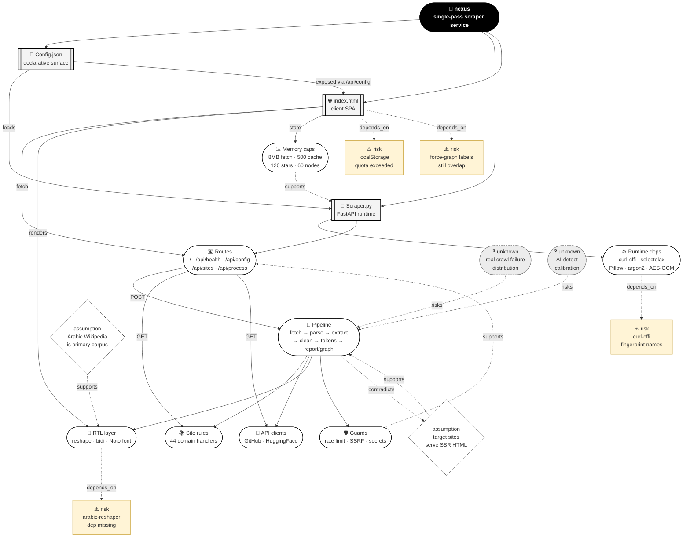

# `/Skeleton` — nexus project mind diagram

**Diagram type:** Mermaid (renders in Obsidian, Notion, GitHub, most MD viewers)

## Legend

| Shape | Meaning |
|---|---|
| Black rounded rect | Root goal |
| Double-bracket rect | Concrete file on disk |
| Rounded rect (plain) | Runtime component |
| Diamond (dashed border) | Assumption that must hold |
| Triangle (amber) | Risk that would break a component |
| Cloud (gray, dashed) | Unknown requiring measurement |
| `-->` | Depends on / flows to |
| `-.->` | Weaker dependency (assumption, risk, or inference) |

## Edge labels

- **loads** — Config.json is read by Scraper.py at startup
- **exposed via** — Config.json values surface to the client through `/api/config`
- **fetch** — Client posts to the server
- **renders** — Client renders RTL text, graphs, reports
- **depends_on** — Failure here breaks the target
- **contradicts** — If reality differs, the assumption fails
- **risks** — Unknown that could invalidate
- **supports** — Reinforces

## Critical path

`GOAL → CONFIG → SERVER → RUNTIME → ROUTES → PIPELINE → RTL → CLIENT`

Every node on this path is a hard dependency. If `Config.json` is malformed, `Scraper.py` won't boot. If `Scraper.py` can't import `curl_cffi`, the pipeline is dead. If RTL shaping is missing, the Arabic report is broken.

## Highest-risk node

**`RISK1 — arabic-reshaper missing`**. It sits directly on the critical path (`RTL -.depends_on.-> RISK1`), it's an optional dependency that silently no-ops, and it produces output that *looks* fine to a Latin reader while being illegible to an Arabic reader. The failure mode is invisible to anyone testing with English content, which is exactly the failure the user reported. It's the only risk on the diagram that both (a) breaks the primary use case shown in the screenshot and (b) is undetectable without deliberately testing Arabic input.