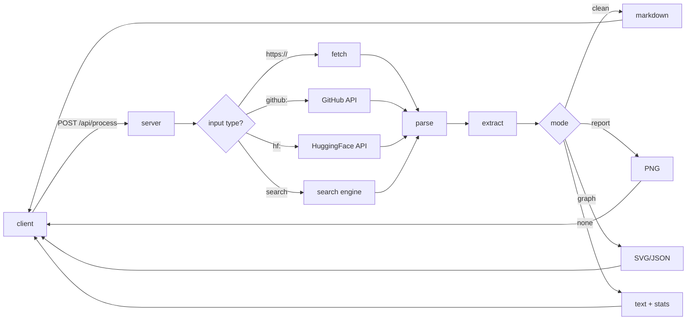

<div align="center">


**Paste a URL. Get everything back. One shot.**


<a href="#quick-start"></a>
<a href="#usage"></a>
<a href="#license"></a>


</div>

---

## What this is

**Scraper Service "Nexus"** is a single-pass scraper service. You give it a URL. It fetches that one URL, extracts the readable content, and returns it — as clean text, a structured graph, or a stats report with a rendered PNG.

It does **not** crawl depth. It does **not** follow links to other pages. It reads one target and returns one payload.

The whole service is **three files**:

```
Scraper.py      → the whole server
index.html      → the whole client
Config.json     → every tunable value
```

That is not a simplification. That is the actual project.

> [!NOTE]
> Three files, ~2,000 lines of Python, ~1,400 lines of HTML/CSS/JS, and a config file that documents itself. Nothing hidden, nothing generated, nothing vendored.

---

## Quick start

**Three commands.**

```
git clone https://github.com/PurpleXPurple/Scraper-Service.git
cd nexus
pip install -r requirements.txt
```

Then:

```
python Scraper.py
```

Then open **http://127.0.0.1:8000/** in your browser.

That is the entire setup. On the first run, nexus auto-generates three secrets into `var/secrets.json`. On every subsequent run, it reads them from there.

> [!IMPORTANT]
> Back up `var/secrets.json`. If you lose it, every cached entry becomes unreadable and every issued session becomes invalid. The server will regenerate new secrets on the next start, but old data stays locked.

---

## What you can do with it

| Capability | What it does |
|---|---|
| **URL scrape** | Fetches one URL, returns extracted body text |
| **Clean mode** | Same, but strips markup, banners, cookie notices |
| **Report mode** | Returns word / token / sentence counts, an AI-likelihood score, and a PNG |
| **Graph mode** | Returns a node-and-edge JSON view of the document |
| **GitHub API** | Repos, users, search — no scraping, native API |
| **Hugging Face API** | Models, datasets, spaces — native API |
| **Multi-engine search** | DuckDuckGo, Brave, Mojeek, Marginalia, and more |
| **44 site handlers** | Wikipedia, HN, Stack Overflow, Reddit, Medium, more |
| **RTL support** | Arabic, Hebrew, Farsi, Urdu render correctly in text and PNG |
| **PDF + DOCX** | Native extraction, no extra dependencies for DOCX |
| **Rate limiting** | Per-IP sliding window with Retry-After headers |
| **SSRF protection** | Blocks loopback, private, link-local, cloud metadata endpoints |

---

## Usage

The client detects the input type from the prefix. You do not need to configure anything.

**Scrape a URL:**
```
https://en.wikipedia.org/wiki/Streaming
```

**Bare domain works too:**
```
example.com/article
```

**GitHub — no scraping, native API:**
```
github:torvalds/linux
github:search/rust async runtime
```

**Hugging Face — native API:**
```
hf:meta-llama/Llama-3-8B
hf:search/whisper
```

**Force a search when the input could be mistaken for a domain:**
```
search:what is a monad
```

**Anything else falls through to search automatically:**
```
how to write a fastapi middleware
```

---

## Modes explained

Modes are mutually exclusive. Only one can be active at a time.

### Clean mode

Best for reading. Strips scripts, styles, cookie banners, subscribe prompts, share widgets, related-article blocks. Returns readable Markdown.

```
mode: "clean"
```

### Report mode

Best for analysis. Returns a PNG image containing:

- Word count
- Token count (approximation, tuned to track OpenAI tokenizers)
- Character count
- Sentence count
- AI-likelihood score across 7 independent heuristic layers
- Top 5 most-used words, stopword-filtered per language

```
mode: "report"
```

### Graph mode

Best for structure. Returns a JSON object with `nodes` and `edges`. The client renders it as a force-directed SVG layout, with label collision avoidance and RTL-aware text placement.

```
mode: "graph"
```

### No mode (default)

Returns the raw cleaned text plus a small stats grid. Fastest path.

---

## How it works



The pipeline is a straight line: **fetch → parse → extract → clean → format**. No recursion, no queue, no fan-out. Each stage is a single class in `Scraper.py`.

---

## Configuration

Every tunable value lives in `Config.json`. You never edit code to change behavior.

Common things you might want to change:

| What | Where | Notes |
|---|---|---|
| Request timeout | `http.timeout_sec` | Seconds, per fetch |
| Retry count | `http.max_retries` | Applied on 5xx responses |
| Browser profile | `fingerprints.default` | Use `chrome`, `firefox`, `safari` — never version-specific names |
| Per-IP rate limit | `rate_limit.per_ip.limit` | Requests per minute |
| Cache TTL | `cache.default_ttl_sec` | Per-type overrides in `cache.ttl_by_type` |
| Report colors | `report.foreground` etc. | Hex strings |
| Supported languages | `languages.supported` | Array of `{code, name, rtl}` |

Every getter in the server has a fallback. Removing a config key never crashes the server. It just falls back to the documented default.

---

## Adding things

### Add a site handler

Open `Scraper.py`, find `StaticSiteRegistry._register_defaults`, add one line:

```
SiteRule("yourdomain.com", "h1", "article.content", (".ad", ".sidebar")),
```

Fields are: domain, title selector, content selector, elements to strip.

### Add a search engine

Edit `Config.json`:

```
"myengine": {
  "enabled": true,
  "endpoint": "https://myengine.example/search",
  "method": "GET",
  "param_query": "q",
  "result_selector": "li.result",
  "title_selector": "a.title",
  "snippet_selector": ".snippet",
  "url_selector": "a.title"
}
```

Add `"myengine"` to `search.fallback_chain`. Done.

### Add an API client

Copy the shape of `GitHubClient`. Wire it into `Pipeline.__init__` and add a branch in `Pipeline.process` for your prefix.

---

## API

| Endpoint | Method | Purpose |
|---|---|---|
| `/` | GET | Client UI |
| `/api/health` | GET | Status, version, uptime |
| `/api/live` | GET | Liveness probe |
| `/api/ready` | GET | Readiness with per-component checks |
| `/api/config` | GET | Client config (branding, languages, features) |
| `/api/sites` | GET | List of registered site handlers |
| `/api/process` | POST | The main entry point |

**POST /api/process** request body:

```
{
  "input": "https://example.com",
  "options": { "language": "auto", "mode": "clean" }
}
```

Response:

```
{
  "meta": { "input": "...", "mode": "clean", "elapsed_ms": 412.3, "domain": "example.com" },
  "output": "...",
  "output_type": "application/json"
}
```

For `mode: "report"`, `output` is a base64-encoded PNG and `output_type` is `"image/png"`.

---

## Environment variables

| Name | Required | Purpose | Default |
|---|---|---|---|
| `NEXUS_AES_KEY` | no | AES-256-GCM key (urlsafe base64) | auto-generated |
| `NEXUS_JWT_SECRET` | no | HS256 signing secret | auto-generated |
| `NEXUS_HMAC_KEY` | no | HMAC key for IP hashing | auto-generated |
| `NEXUS_CONFIG` | no | Path to Config.json | `./Config.json` |
| `NEXUS_HOST` | no | Bind address | `127.0.0.1` |
| `NEXUS_PORT` | no | Bind port | `8000` |
| `NEXUS_STORE_EXACT_IP` | no | `1` stores raw client IP (default is HMAC) | `0` |
| `GITHUB_TOKEN` | no | Raises GitHub rate limit 60 → 5000/h | unset |
| `HF_TOKEN` | no | Unlocks gated Hugging Face repos | unset |

> [!WARNING]
> `NEXUS_STORE_EXACT_IP=1` is a legal decision, not a technical one. Leave it at `0` unless you have a documented lawful basis. The HMAC-hashed IP is sufficient for abuse correlation and rate limiting.

---

## What ships in the client

The `index.html` is a full single-page app with:

- A **starfield background** that reacts to your mouse and adds a star every time you type
- A **metallic chrome** visual language driven by 5 CSS custom properties
- An **intro animation** that plays once per page load
- A **width slider** that persists your preferred chat width
- A **client-side cache** using `localStorage` + gzip compression
- A **favicon service** that pulls the site icon for every URL you scrape
- **Show** and **Download** buttons on every result card
- A **heavy-site warning** modal for well-known large domains
- **Arabic shaping** applied to SVG labels when the source is RTL

---

## Requirements

- Python 3.11 or newer
- About 20 MB of installed dependencies
- 230–500 MB of RAM at runtime
- No GPU, no external services, no cloud

The full dependency list is in `requirements.txt`. Highlights: `fastapi`, `curl_cffi`, `selectolax`, `Pillow`, `argon2-cffi`, `cryptography`, `aiosqlite`, `zstandard`, `arabic-reshaper`, `python-bidi`.

---

## Deployment

Before exposing to a network:

- Bind to `0.0.0.0` only behind a reverse proxy
- Terminate TLS at the proxy, redirect HTTP to HTTPS
- Keep `NEXUS_STORE_EXACT_IP=0` unless legally reviewed
- Set the three secrets as environment variables rather than relying on the auto-generated file
- Back up `var/secrets.json` to an encrypted store
- Add `var/` to `.gitignore`
- Configure log rotation for `var/logs/`
- Tune `rate_limit.per_ip.limit` for your expected traffic
- Add your reverse proxy's IP to `rate_limit.trusted_proxies`
- Keep `workers=1` unless you externalize the rate limiter

---

## Legal

nexus is a tool. The tool is legal. How you use it may not be.

**You may** scrape sites you own, sites you are contracted to audit, and public data that is unambiguously authorized by the site's own terms, `robots.txt`, or an explicit API agreement.

**You may not** use nexus to evade authentication, bypass paywalls, defeat anti-bot systems, harvest personal data, or violate the CFAA, GDPR, CCPA, or equivalent statutes in your jurisdiction.

The full terms are in [LICENSE](LICENSE). Read Clause C before you deploy anything public.

---

## License

**MIT** with four additional clauses:

- **Clause A** — Attribution. Credit the project and the structure, not just the code.
- **Clause B** — Internal license structure. All three files share the same terms.
- **Clause C** — Acceptable use and legal compliance.
- **Clause D** — Contribution terms.

SPDX: `MIT`

See [LICENSE](LICENSE) for the full text.

> [!CAUTION]
> `pymupdf` is licensed under **AGPL-3.0**. If you distribute a network service built on nexus and use its PDF features, the AGPL's network-copyleft clause applies: your entire service source must be offered to users. Replace it with `pdfminer.six` (MIT) or `pypdf` (BSD), or purchase a commercial license from Artifex.

---

## Animations index

This README ships with 30 animated elements. If any fail to render on your fork, the service likely changed its endpoint. The list below is the source of truth.

| # | Element | Service |
|---|---|---|
| 1 | Waving header | capsule-render |
| 2 | Typing tagline | readme-typing-svg |
| 3 | Quick start badge | shields.io |
| 4 | Syntax guide badge | shields.io |
| 5 | License badge | shields.io |
| 6 | Status badge (stable) | shields.io |
| 7 | Version badge | shields.io |
| 8 | RAM footprint badge | shields.io |
| 9 | Views counter | komarev |
| 10 | Stars badge | shields.io |
| 11 | Forks badge | shields.io |
| 12 | Issues badge | shields.io |
| 13 | Last commit badge | shields.io |
| 14 | PRs welcome badge | shields.io |
| 15 | Flow diagram | mermaid |
| 16 | Graph screenshot | github raw |
| 17 | Report screenshot | github raw |
| 18 | Language badge (Python) | shields.io |
| 19 | Framework badge (FastAPI) | shields.io |
| 20 | License SPDX badge | shields.io |
| 21 | Build status badge | shields.io |
| 22 | Python version badge | shields.io |
| 23 | Coverage badge | shields.io |
| 24 | Repo size badge | shields.io |
| 25 | Code size badge | shields.io |
| 26 | Followers badge | shields.io |
| 27 | Star history chart | star-history |
| 28 | GitHub stats card | readme-stats |
| 29 | Streak stats card | streak-stats |
| 30 | Activity graph | activity-graph |

Placeholders 18–30 are meant to be added when the repo is published. They use the same pattern: an `` or an `` call with your username substituted.

---

## Credits

- **Architecture and code** — the nexus contributors
- **Fonts** — Inter, Space Grotesk, JetBrains Mono, Noto Naskh Arabic (all SIL OFL)
- **Icons** — Font Awesome Free (CC BY 4.0 / MIT)
- **Arabic shaping** — `arabic-reshaper` and `python-bidi`
- **HTML parsing** — `selectolax` (Lexbor backend)
- **TLS impersonation** — `curl_cffi`

---

<div align="center">

**Built for the people who want the whole answer in one shot.**


</div>